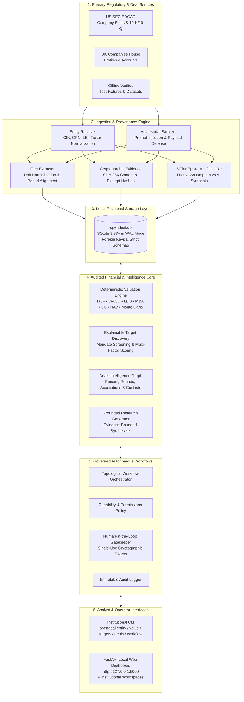

# OpenDeal

<div align="center">

[](https://opensource.org/licenses/Apache-2.0)
[](https://www.python.org/)
[-brightgreen.svg)](tests/)
[](audit/PHASE_11_RELEASE_READINESS_REPORT.md)
[](#deterministic-valuation-engine)
[](#security-hardening--data-privacy)
[](https://github.com/udaydomadiya08/openDeal)

**Institutional-grade, local-first intelligence platform for private-market deal sourcing, regulatory corporate research, and deterministic financial valuation.**

[What is OpenDeal?](#what-is-opendeal) •
[End-to-End Architecture](#end-to-end-architecture) •
[Quickstart](#quickstart-in-3-minutes) •
[User Guide](#user-guide--workflows) •
[Valuation Models](#deterministic-valuation-engine) •
[Web Dashboard](#local-web-dashboard) •
[CLI Reference](#cli-reference) •
[Project Roadmap](#project-roadmap--evolution)

</div>

---

## What is OpenDeal?

### The Core Problem

Investment analysts, corporate development teams, and private equity sponsors face a critical dilemma:

1. **Legacy Terminals:** Cost $25,000+ per user annually, lock proprietary analysis inside closed proprietary clouds, and provide opaque data aggregation.
2. **Generic LLM & "AI Agents":** Hallucinate financial multiples, fabricate revenue figures, substitute zeroes for undisclosed line items, and risk leaking confidential deal terms to remote model providers.

### The OpenDeal Solution

**OpenDeal** is a local-first, self-contained financial intelligence workstation built from first principles. It delivers institutional-grade deal screening, verifiable corporate research, and audited financial valuation entirely on standard developer and analyst laptops—with **zero external cloud dependencies, zero network telemetry, and 100% reproducible math**.

---

## Key Pillars: What Makes OpenDeal Different

| Pillar | How OpenDeal Solves It |
| :--- | :--- |
| **Deterministic Math** | All financial calculations (DCF, WACC, LBO, M&A Accretion/Dilution, VC Method, NAV, Monte Carlo) execute strictly in audited Python arithmetic. Generative AI is mathematically forbidden from computing or overriding numeric financials. |
| **Regulatory Evidence Provenance** | Every financial metric links directly to official regulatory filings (SEC EDGAR 10-K/10-Q and UK Companies House) with document ID, filing period, verbatim excerpt, and SHA-256 cryptographic content hash. |
| **5-Tier Epistemic Taxonomy** | Facts are strictly segregated into explicit epistemic categories: `SOURCE_REPORTED_FACT`, `DERIVED_CALCULATION`, `ANALYST_ASSUMPTION`, `AI_INTERPRETATION`, and `MISSING_OR_CONFLICTING`. Missing disclosures remain missing—never fabricated. |
| **Local-First & Modest Hardware** | Runs self-contained on consumer hardware (e.g., Apple Silicon M-series or Intel Core i5 with 8 GB RAM) using SQLite with WAL mode. External network requests are disabled by default. |
| **Governed Autonomous Agents** | Specialized agents run in a topological DAG workflow engine with human-in-the-loop approvals, cryptographically signed single-use action tokens, and tamper-evident audit trails. |

---

## End-to-End Architecture

The following unified architecture diagram demonstrates how raw regulatory filings and deal records flow through OpenDeal's ingestion, evidence validation, valuation, and presentation layers:



---

## Quickstart in 3 Minutes

### 1. Installation

Clone the repository and install OpenDeal in an isolated Python environment:

```bash
# Clone the repository
git clone https://github.com/udaydomadiya08/openDeal.git
cd openDeal

# Create and activate a virtual environment (Python 3.9+)
python3 -m venv .venv
source .venv/bin/activate

# Install OpenDeal with development dependencies
pip install --upgrade pip
pip install -e ".[dev]"
```

### 2. Verify System Health

Verify that the CLI is functional, database connectivity is initialized, and dependencies are verified:

```bash
opendeal system status
```

Expected output:
```text
=== OpenDeal System Status ===
Version:             0.11.0rc1
Database Path:       /Users/username/Library/Application Support/OpenDeal/opendeal.db
Database Connected:  True
Companies Count:     42
Facts Count:         1240
PEAK Golden Master:  VERIFIED_INTACT (ae2343527fb3...)
```

### 3. Launch the Local Web Dashboard

Start the local web application:

```bash
opendeal ui run
```

Open your browser to:
**`http://127.0.0.1:8000`**

---

## User Guide & Workflows

### Workflow 1: Corporate Research & Regulatory Fact Extraction

Search for a company, ingest official SEC or UK Companies House disclosures, and inspect verifiable facts:

```bash
# 1. Search for a company across jurisdictions
opendeal entity search "Apple Inc"

# 2. Ingest filings from offline fixtures or official sources
opendeal ingest fixture --file tests/fixtures/sec_edgar_sample.json

# 3. View extracted financial facts and cryptographic evidence citations
opendeal company facts CIK:0000320193 --metric net_income

# 4. Generate an evidence-grounded research brief
opendeal research brief CIK:0000320193 --scope FINANCIALS_AND_OPERATIONS
```

---

### Workflow 2: Deterministic Financial Valuation

Run mathematically audited financial models with complete parameter visibility and zero LLM numeric hallucinations.

#### CLI Usage Examples:

```bash
# Discounted Cash Flow (DCF) with Mid-Year Convention
opendeal valuation dcf CIK:0000320193 --discount-rate 0.085 --terminal-growth 0.025

# Leveraged Buyout (LBO) Model with Senior Debt and Cash Sweeps
opendeal valuation lbo \
  --entry-ev 100.0 \
  --exit-multiple 10.0 \
  --exit-ebitda 12.0 \
  --senior-debt 40.0 \
  --subordinated-debt 20.0 \
  --interest-rate 0.06 \
  --holding-period 5

# Venture Capital (VC) Method Valuation
opendeal valuation vc \
  --investment 5.0 \
  --pre-money 20.0 \
  --exit-val 150.0 \
  --years 5.0 \
  --dilution 0.20

# M&A Accretion/Dilution Analysis
opendeal valuation ma \
  --buyer-price 150.0 \
  --buyer-shares 100.0 \
  --buyer-net-income 500.0 \
  --target-net-income 80.0 \
  --target-equity-value 1000.0 \
  --cash-pct 0.40 \
  --debt-pct 0.40 \
  --stock-pct 0.20
```

#### Python SDK Usage Example:

You can also use OpenDeal's deterministic math engines directly in Python scripts or Jupyter Notebooks:

```python
from opendeal.valuation.engine.contracts import VentureCapitalInput, VCExitScenario, DilutionRound
from opendeal.valuation.engine.vc import calculate_venture_capital

# Configure Series A investment parameters
vc_input = VentureCapitalInput(
    investment_amount=5_000_000,
    pre_money_valuation=20_000_000,
    dilution_rounds=[
        DilutionRound(round_name="Series B", dilution_percentage=0.20)
    ],
    exit_scenarios=[
        VCExitScenario(
            scenario_name="Base Case Exit",
            exit_valuation=150_000_000,
            holding_period_years=5.0,
            liquidation_preference_multiple=1.0,
            is_participating=False
        )
    ]
)

result = calculate_venture_capital(vc_input)

print(f"Status:        {result.status.value}")
print(f"Post-Money:    ${result.post_money_valuation / 1e6:.1f}M")
print(f"Target Own %:  {result.initial_ownership_percentage * 100:.1f}%")
print(f"Exit Own %:    {result.exit_ownership_percentage * 100:.1f}%")

for sc in result.scenario_results:
    print(f"Scenario [{sc.scenario_name}]: Proceeds=${sc.investor_proceeds / 1e6:.1f}M, MOIC={sc.moic:.2f}x, IRR={sc.irr * 100:.2f}%")
```

---

### Workflow 3: Acquisition Target Screening & Deal Sourcing

Screen corporate entities against custom investment mandates with full explainability of exclusions and composite factor scoring:

```bash
# 1. Screen targets by sector, jurisdiction, revenue, and EBITDA margin
opendeal targets screen \
  --sector "Technology" \
  --jurisdiction "US" \
  --min-revenue 10000000 \
  --min-ebitda-margin 0.15

# 2. Inspect exact mathematical scoring and rule-by-rule eligibility breakdown
opendeal targets explain CIK:0001018724

# 3. Create a target watchlist and add prospective companies
opendeal targets list create "SaaS Acquisition Candidates" --description "B2B Cloud Mandate"
opendeal targets list add "SaaS Acquisition Candidates" CIK:0001018724
opendeal targets lists
```

---

### Workflow 4: Private-Market Deals & Transaction Intelligence

Track funding rounds, M&A acquisitions, investor syndicates, and reconcile contradictory deal announcements:

```bash
# 1. View full deals dossier for an entity (funding rounds, acquisitions, investors)
opendeal deals company CIK:0001018724

# 2. Inspect documented investors and syndicate participants
opendeal deals investors CIK:0001018724

# 3. View chronological corporate transaction timeline
opendeal deals timeline CIK:0001018724

# 4. Review external source conflicts (e.g. conflicting round sizes or dates)
opendeal deals conflicts
```

---

### Workflow 5: Governed Autonomous Workflows

Execute multi-stage DAG intelligence workflows with human-in-the-loop approval gates:

```bash
# 1. Run the standard company intelligence dossier workflow
opendeal workflow run wf_company_dossier --entity-id CIK:0000320193

# 2. Inspect pending privileged actions requiring human approval
opendeal workflow pending

# 3. Approve a pending action using its cryptographic token
opendeal workflow approve <APPROVAL_ID> --rationale "Mandate reviewed and validated"

# 4. Inspect immutable execution audit trail
opendeal workflow audit <RUN_ID>
```

---

## Deterministic Valuation Engine

OpenDeal includes 8 audited quantitative financial valuation models:

| Model | Valuation Method | Primary Inputs | Key Outputs |
| :--- | :--- | :--- | :--- |
| **DCF** | Discounted Cash Flow | Unlevered Free Cash Flows, WACC, Terminal Growth Rate | Enterprise Value, Equity Value, PV Explicit Cash Flows, PV Terminal Value |
| **WACC** | Cost of Capital | Risk-free rate, Market Risk Premium, Beta, Cost of Debt, Tax Rate | Weighted Average Cost of Capital, Capital Structure Weights |
| **Gordon Growth** | Perpetual Growth TV | Terminal Year FCF, Discount Rate, Perpetual Growth Rate | Terminal Enterprise Value, Capitalization Rate |
| **LBO** | Leveraged Buyout | Entry EV, Exit Multiple, Senior Debt, Subordinated Debt, Cash Sweep | Sponsor Equity, Exit Equity, MOIC (Multiple on Invested Capital), IRR |
| **M&A** | Accretion / Dilution | Buyer EPS, Target Net Income, Purchase Price, Consideration Mix | Pro Forma EPS, Accretion/Dilution %, Synergies Breakeven |
| **VC** | Venture Capital Method | Investment Amount, Pre/Post-Money Valuation, Exit Valuation, Dilution | Target Ownership %, Retained Exit Ownership %, Investor Proceeds, MOIC, IRR |
| **NAV** | Net Asset Value | Book Assets, Asset Adjustments, Total Debt, Liabilities | Adjusted Asset Value, Net Asset Value, Adjusted Equity Value |
| **Monte Carlo** | Probabilistic Simulation | Parameter Distributions (Mean, Std Dev, Min, Max), Iterations | Valuation Percentiles (P10, P50, P90), Standard Deviation, Value-at-Risk |

---

## Local Web Dashboard

OpenDeal features an integrated institutional web application powered by FastAPI, accessible locally at **`http://127.0.0.1:8000`**:

| Route | Workspace | Description |
| :--- | :--- | :--- |
| `/` | **Executive Overview** | System operational metrics, entity counts, facts volume, and PEAK master verification. |
| `/companies` | **Company Explorer** | Search, filter, and inspect corporate profiles, CIK, CRN, LEI, and filing histories. |
| `/facts` | **Facts & Evidence** | Filter facts by metric, view verbatim excerpts, filing dates, and SHA-256 evidence hashes. |
| `/valuation` | **Valuation Hub** | Interactive forms for DCF, WACC, LBO, M&A, VC, and NAV models with instant computation. |
| `/research` | **Research Briefs** | Generate and read structured, evidence-bounded intelligence briefs. |
| `/discovery` | **Target Discovery** | Screen candidate companies against financial criteria and manage target watchlists. |
| `/deals` | **Deals Intelligence** | Explore financing rounds, M&A transactions, investor syndicate networks, and conflicts. |
| `/workflows` | **Workflows & Approvals** | Monitor DAG execution progress, inspect execution logs, and resolve human-in-the-loop approvals. |
| `/system` | **System Health & Audit** | Database configuration, storage migrations, and security defense verification. |

---

## CLI Reference

The `opendeal` command-line utility provides complete operator control:

| Command Group | Command | Description |
| :--- | :--- | :--- |
| **System** | `opendeal system status` | Check database connection, version, counts, and golden master integrity. |
| **Entity** | `opendeal entity search <QUERY>` | Search corporate entities across US and UK jurisdictions. |
| | `opendeal entity show <ID>` | View comprehensive entity profile and legal identifiers. |
| **Ingestion** | `opendeal ingest fixture --file <PATH>` | Ingest structured regulatory facts from local verified fixture files. |
| | `opendeal ingest sec-edgar <CIK>` | Ingest filings from official SEC EDGAR disclosures (requires live flag). |
| **Valuation** | `opendeal valuation dcf <ID>` | Compute Discounted Cash Flow valuation. |
| | `opendeal valuation lbo` | Compute Leveraged Buyout returns (IRR, MOIC). |
| | `opendeal valuation vc` | Compute Venture Capital returns across exit scenarios. |
| | `opendeal valuation ma` | Compute M&A accretion/dilution and pro forma EPS. |
| | `opendeal valuation monte-carlo` | Run probabilistic valuation distributions. |
| **Targets** | `opendeal targets screen` | Screen targets by revenue, margin, sector, and jurisdiction. |
| | `opendeal targets explain <ID>` | Inspect step-by-step scoring breakdown for a target. |
| | `opendeal targets lists` | View and manage saved target lists and watchlists. |
| **Deals** | `opendeal deals company <ID>` | View full deals summary (funding, M&A, investors). |
| | `opendeal deals investors <ID>` | View investor syndicate network for a company. |
| | `opendeal deals timeline <ID>` | View chronological financing and M&A timeline. |
| | `opendeal deals conflicts` | Audit conflicting deal observations across sources. |
| **Workflows** | `opendeal workflow run <ID>` | Execute an autonomous workflow blueprint. |
| | `opendeal workflow pending` | View actions awaiting human authorization. |
| | `opendeal workflow approve <ID>` | Authorize a pending privileged action. |
| | `opendeal workflow audit <ID>` | View immutable audit trail for a workflow run. |
| **UI** | `opendeal ui run` | Launch the local web dashboard (`127.0.0.1:8000`). |

---

## Project Roadmap & Evolution

The development of OpenDeal followed an audited, progressive engineering roadmap. Each phase introduced verified institutional capabilities:

| Milestone | Code | Key Capabilities Delivered |
| :--- | :--- | :--- |
| **Phase 0** | Baseline Architecture | Core package structure, configuration system, dependency boundaries, and audit harness. |
| **Phase 1** | Verified Foundation | Offline regulatory fixtures, SEC EDGAR & UK Companies House connectors, and path-safe storage. |
| **Phase 2** | Cryptographic Provenance | SHA-256 evidence hashing, source document linking, and 5-tier epistemic knowledge classification. |
| **Phase 3** | Entity Resolution | Cross-jurisdiction entity resolution (CIK, CRN, LEI, Ticker) and deterministic matching algorithms. |
| **Phase 4** | Fact Extraction & Storage | Relational SQLite persistence, schema migrations, and conflict-preserving multi-source ingestion. |
| **Phase 5** | Qualitative Intelligence | Grounded research briefs, evidence-bounded commentary, and prompt-injection sanitization. |
| **Phase 6** | Local Web UI | FastAPI local dashboard, 9 operational workspaces, responsive layouts, and zero external CDNs. |
| **Phase 7** | Deterministic Valuation | Audited DCF, WACC, Gordon Growth, NAV, and PEAK Golden Master verification bridge. |
| **Phase 8** | Deal Sourcing & Discovery | Mandate screening engine, multi-factor scoring (scale, profitability, quality), and watchlists. |
| **Phase 9** | Private Deals Intelligence | Funding rounds tracking, M&A history, investor syndicate graph, and cross-source conflict detection. |
| **Phase 10** | Governed Autonomous Agents | Topological DAG runner, policy gatekeeper, single-use approval tokens, and immutable audit logs. |
| **Phase 11** | Release Candidate Hardening | Default-path database safety, 100% reproducible wheel/sdist packaging, and security regression gates. |

---

## Security Hardening & Data Privacy

OpenDeal is engineered for highly sensitive financial intelligence where data leakage is unacceptable:

1. **Loopback-Only Binding:** By default, all servers bind exclusively to `127.0.0.1`. Remote network binding (`0.0.0.0`) is rejected unless explicitly passed `--allow-remote`.
2. **Host Authority & DNS Rebinding Defenses:** Pure ASGI middleware strictly validates Host headers against an approved local whitelist (`127.0.0.1`, `localhost`, `::1`).
3. **Cross-Origin & CSRF Defense:** Blocks cross-origin state-changing HTTP requests (`POST`, `PUT`, `DELETE`).
4. **Streaming Payload Protection:** Enforces a 10 MB maximum request body limit with HTTP 413, independent of `Content-Length` headers.
5. **Terminal State Immutability:** Execution records that reach `COMPLETED`, `FAILED`, or `CANCELLED` cannot be overwritten or altered.
6. **Single-Use Cryptographic Tokens:** Privileged actions require single-use approval tokens that expire immediately upon consumption.
7. **Automated Secret Redaction:** API keys, Bearer tokens, private keys, and passwords are automatically scrubbed from logs and audit trails.

---

## Testing & Build Verification

OpenDeal maintains comprehensive test coverage across unit math, workflow policies, and adversarial security defenses:

```bash
# Run the complete test suite
PYTHONPATH=src pytest -v

# Run the test suite with line-by-line coverage
PYTHONPATH=src pytest --cov=opendeal --cov-report=term-missing

# Run security-critical regression tests
PYTHONPATH=src pytest tests/test_security.py -v

# Verify 100% byte-for-byte release artifact reproducibility
python3 audit/verify_reproducibility.py
```

- **Test Suite:** **397 / 397 tests passing (100%)**
- **Code Coverage:** **90% total coverage**
- **Reproducibility:** Wheel and Source Distribution (`.tar.gz`) match 100% byte-for-byte across independent clean-room builds under `SOURCE_DATE_EPOCH`.

---

## Repository Structure

```text
opendeal/
├── src/opendeal/              # Core application package
│   ├── agents/               # Autonomous workflow orchestrator, policies, and runner
│   ├── config/               # Settings, environment paths, and safe database defaults
│   ├── core/                 # Shared domain types, enums, and epistemic tier contracts
│   ├── deals/                # Funding rounds, transactions, and investor syndicate graph
│   ├── discovery/            # Deal sourcing, eligibility rules, and multi-factor scoring
│   ├── entities/             # Corporate entity resolution and registry mapping
│   ├── evidence/             # Cryptographic evidence provenance models (SHA-256)
│   ├── facts/                # Fact extraction, epistemic tagging, and conflict preservation
│   ├── pipeline/             # Multi-stage extraction and normalization orchestrator
│   ├── research/             # Grounded intelligence generator and brief synthesis
│   ├── sources/              # SEC EDGAR and UK Companies House connectors
│   ├── storage/              # SQLite relational store, WAL configuration, and migrations
│   ├── ui/                   # FastAPI server, route controllers, templates, and static assets
│   └── valuation/            # Deterministic math engines (DCF, WACC, LBO, M&A, VC, NAV)
├── tests/                    # Complete test suite (397 tests)
│   ├── conftest.py           # Pytest session isolation and temp database fixtures
│   ├── fixtures/             # Offline SEC, Companies House, and deal sample files
│   └── test_*.py             # Unit, integration, security, and reproducibility tests
├── audit/                    # Verification reports, source manifest, and reproducibility scripts
├── .github/workflows/        # Continuous integration workflows
├── .env.example              # Environment configuration template
├── .gitignore                # Comprehensive secret, workbook, and cache exclusions
├── LICENSE                   # Apache License 2.0
├── MANIFEST.in               # Source package inclusion manifest
├── pyproject.toml            # Project packaging specification (PEP 517/621)
└── README.md                 # Public documentation and operator guide
```

---

## License

OpenDeal is released under the **Apache License, Version 2.0**. See the [LICENSE](LICENSE) file for complete details.

```text
Copyright 2026 OpenDeal Contributors

Licensed under the Apache License, Version 2.0 (the "License");
you may not use this file except in compliance with the License.
You may obtain a copy of the License at

    http://www.apache.org/licenses/LICENSE-2.0

Unless required by applicable law or agreed to in writing, software
distributed under the License is distributed on an "AS IS" BASIS,
WITHOUT WARRANTIES OR CONDITIONS OF ANY KIND, either express or implied.
See the License for the specific language governing permissions and
limitations under the License.
```
