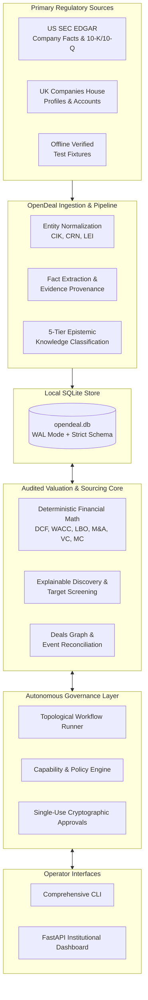
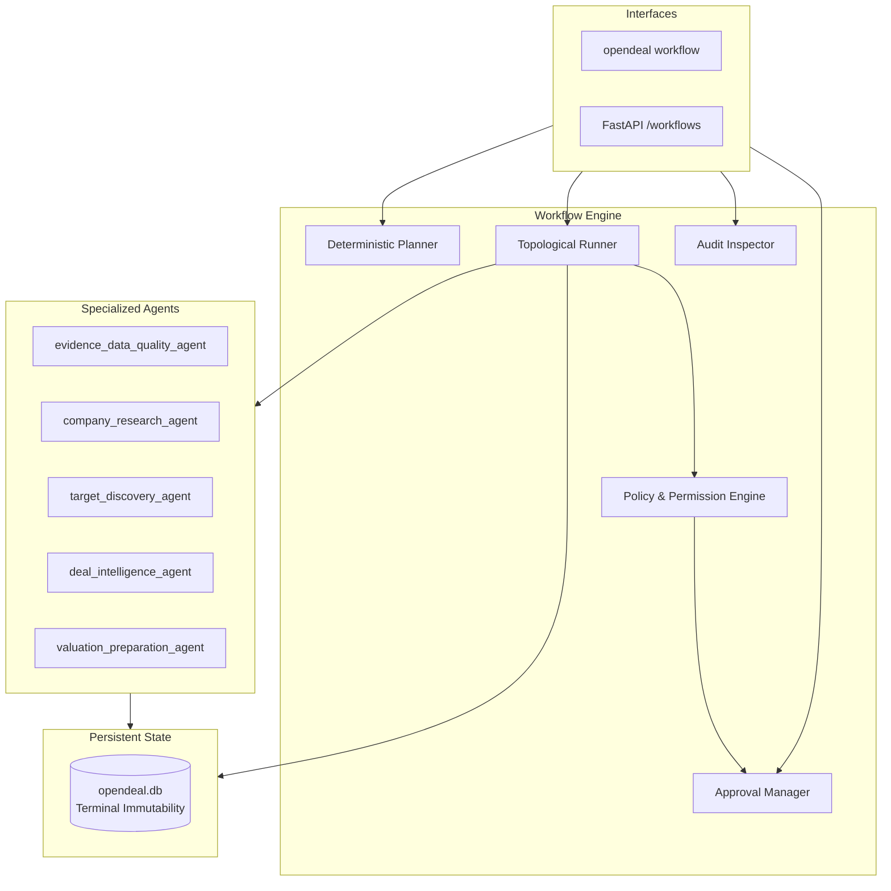
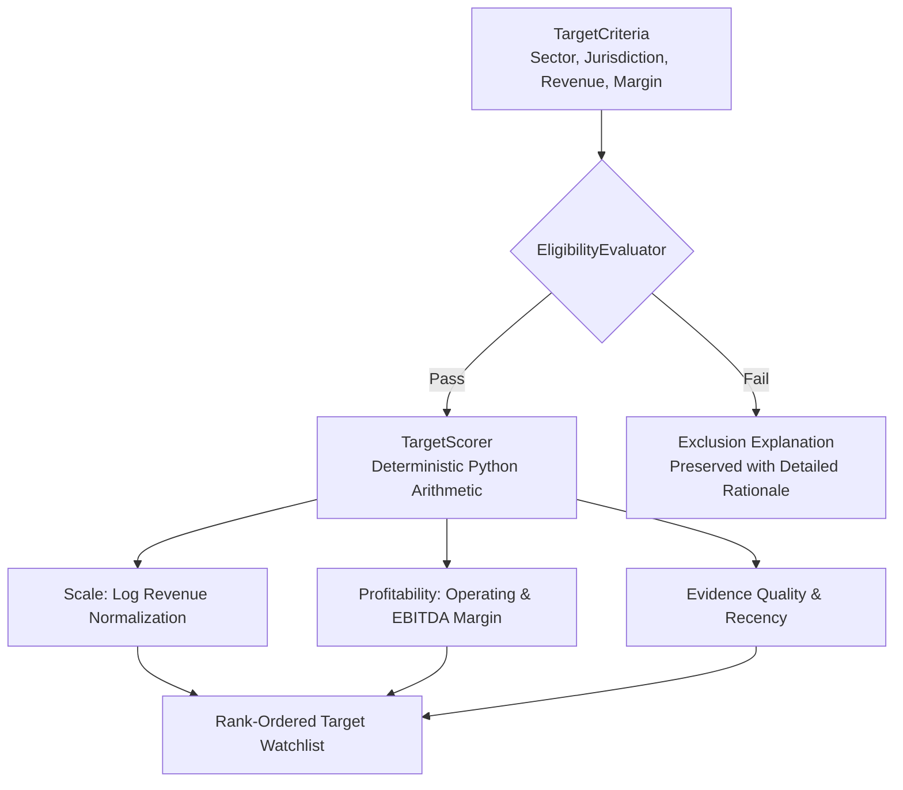

# OpenDeal

<div align="center">

[](https://opensource.org/licenses/Apache-2.0)
[](https://www.python.org/)
[-brightgreen.svg)](tests/)
[](audit/PHASE_11_RELEASE_READINESS_REPORT.md)
[](#architecture-principles)
[](#deterministic-valuation-engines)
[](https://github.com/udaydomadiya08/openDeal)

**Institutional-grade, local-first intelligence, corporate research, deal sourcing, and deterministic financial valuation platform.**

[Quickstart](#quickstart) •
[Features](#key-capabilities) •
[Valuation Models](#deterministic-valuation-engines) •
[Web Dashboard](#local-web-dashboard--ui) •
[CLI Guide](#command-line-interface-cli) •
[Security & Privacy](#security-hardening--data-privacy) •
[Testing & Audits](#testing--verification)

</div>

---

## Executive Overview

**OpenDeal** is a modular, analyst-workstation platform built from first principles for private equity sponsors, corporate development teams, and M&A analysts. 

Unlike conventional financial tools that rely on cloud subscriptions or AI engines prone to numeric hallucinations, OpenDeal combines:
1. **Primary Regulatory Filings:** Grounded strictly in official SEC EDGAR and UK Companies House records with full cryptographic evidence citations.
2. **Deterministic Mathematical Engines:** Quantitative models (DCF, WACC, LBO, M&A Accretion/Dilution, NAV, Monte Carlo, Venture Capital) execute in audited, zero-network Python arithmetic completely decoupled from LLMs.
3. **Local-First & Modest Hardware Feasibility:** Runs self-contained on standard workstations (e.g., Apple Silicon M-series with 8 GB RAM) with SQLite storage, requiring zero external cloud dependencies.
4. **Autonomous Agent Governance:** Human-in-the-loop permissioning, single-use approval tokens, and immutable terminal execution histories.

---

## Table of Contents

- [Architecture Principles](#architecture-principles)
- [Key Capabilities](#key-capabilities)
- [Quickstart](#quickstart)
  - [Installation](#1-installation)
  - [Initialization & Status](#2-initialization--status)
  - [Launching the Web Dashboard](#3-launching-the-web-dashboard)
- [Deterministic Valuation Engines](#deterministic-valuation-engines)
- [Autonomous Agents & Workflows](#autonomous-agents--workflows)
- [Deal Sourcing & Target Discovery](#deal-sourcing--target-discovery)
- [Private-Market Deals Intelligence](#private-market-deals-intelligence)
- [Local Web Dashboard & UI](#local-web-dashboard--ui)
- [Command-Line Interface (CLI)](#command-line-interface-cli)
- [Security Hardening & Data Privacy](#security-hardening--data-privacy)
- [Testing & Verification](#testing--verification)
- [Repository Structure](#repository-structure)
- [License](#license)

---

## Architecture Principles



1. **Primary Source Grounding:** Financial facts originate strictly from official regulatory filings. Missing data is preserved as `MISSING_OR_CONFLICTING`—never fabricated, estimated, or converted to zero.
2. **Deterministic Financial Math:** Quantitative formulas execute deterministically in audited Python engines and sandbox workbooks. AI synthesis never computes or overrides numeric financials.
3. **Immutable Provenance:** Every financial observation retains full lineage: source document ID, period, currency, verbatim text extract, and SHA-256 cryptographic payload hash.
4. **Epistemic Knowledge Tiers:** All factual claims are strictly partitioned into 5 explicit tiers:
   - `SOURCE_REPORTED_FACT`: Direct assertions backed by verifiable primary filing citations.
   - `DERIVED_CALCULATION`: Deterministic formulas computed by reproducible code.
   - `ANALYST_ASSUMPTION`: Explicitly labeled model inputs (e.g. exit multiple, discount rate), never disguised as fact.
   - `AI_INTERPRETATION`: Qualitative analytical commentary bounded by evidence.
   - `MISSING_OR_CONFLICTING`: Systematically identified disclosure gaps and preserved contradictory observations.
5. **Zero-Network Default:** Standard operations, valuation math, screening, and testing execute completely offline with zero telemetry or network calls.

---

## Key Capabilities

| Domain | Capability | Description |
| :--- | :--- | :--- |
| **Corporate Intelligence** | Regulatory Ingestion | Automated ingestion from SEC EDGAR (XBRL Company Facts, Submissions) and UK Companies House with rate-limiting compliance. |
| **Financial Valuation** | Deterministic Engines | 8 audited valuation models: DCF, CAPM/WACC, Gordon Growth, Net Asset Value (NAV), LBO, M&A Accretion/Dilution, Monte Carlo, and Venture Capital. |
| **Deal Sourcing** | Target Screening | Multi-factor eligibility screening, log-scale revenue normalization, profitability scoring, and explainable gate exclusions. |
| **Private-Market Deals** | Transaction Graph | Funding rounds, investors, syndicates, M&A acquisitions, debt facilities, chronological deal timelines, and conflict resolution. |
| **Agentic Workflows** | Autonomous Orchestration | 5 standard blueprints for research, screening, valuation, monitoring, and audit with human approval gates. |
| **Operator UI** | Local Web Dashboard | High-performance FastAPI and Jinja2 interface with dark-mode financial styling, charts, and interactive workspaces. |
| **Security & Auditing** | Institutional Hardening | DNS rebinding defenses, Host authority validation, CSRF protections, terminal record immutability, and secret redaction. |

---

## Quickstart

### 1. Installation

Requires **Python 3.9+** (tested on 3.9, 3.10, 3.11, 3.12).

```bash
# Clone the repository
git clone https://github.com/udaydomadiya08/openDeal.git
cd openDeal

# Create and activate an isolated virtual environment
python3 -m venv venv
source venv/bin/activate

# Upgrade package tooling
pip install --upgrade pip setuptools wheel

# Install in editable mode with development dependencies
pip install -e .[dev]
```

### 2. Initialization & Status

Verify installation, environment configuration, and database connectivity:

```bash
# Verify CLI binary
opendeal --version
opendeal --help

# Inspect system operational status and database connection
opendeal status
opendeal status --json
```

### 3. Launching the Web Dashboard

OpenDeal includes a local-first, zero-network institutional web interface:

```bash
# Launch dashboard on localhost:8000
opendeal ui

# Open in browser:
# http://127.0.0.1:8000
```

To specify custom ports or databases:
```bash
opendeal ui --port 8080 --db-path /path/to/custom.db
```

---

## Deterministic Valuation Engines

OpenDeal provides audited valuation modules implemented in `src/opendeal/valuation/engine/`. All mathematical operations are 100% reproducible:

```
                                  Valuation Engine Suite
 ┌───────────────────────────┬───────────────────────────┬───────────────────────────┐
 │   Discounted Cash Flow    │   Weighted Average Cost   │      Gordon Growth &      │
 │          (DCF)            │       of Capital (WACC)   │      Exit Multiples       │
 │ Mid-year/Year-end conven. │ CAPM Equity + Taxed Debt  │ Terminal Value Benchmarks │
 ├───────────────────────────┼───────────────────────────┼───────────────────────────┤
 │   Leveraged Buyout (LBO)  │    M&A Accretion/Dilution │    Venture Capital (VC)   │
 │ Senior/Mezz tranches, IRR │ Pro-forma EPS, synergies  │ Pre/Post, dilution, MOIC  │
 ├───────────────────────────┴───────────────────────────┴───────────────────────────┤
 │   Monte Carlo DCF Simulation  │  Net Asset Value (NAV)  │  PEAK Excel Sandbox     │
 │ Normal/lognormal distribs     │ Asset adjustment bridge │ Cryptographic isolation │
 └───────────────────────────────┴─────────────────────────┴─────────────────────────┘
```

### Example: Venture Capital Valuation (Python API)

```python
from opendeal.valuation.engine.contracts import (
    DilutionRound,
    VCExitScenario,
    VentureCapitalInput,
)
from opendeal.valuation.engine.venture_capital import calculate_venture_capital

inp = VentureCapitalInput(
    investment_amount=5.0,        # $5.0M Investment
    pre_money_valuation=15.0,     # $15.0M Pre-money Valuation
    dilution_rounds=[
        DilutionRound(round_name="Series B", dilution_percentage=0.20),
        DilutionRound(round_name="Option Pool", dilution_percentage=0.10),
    ],
    exit_scenarios=[
        VCExitScenario(scenario_name="Base", exit_valuation=100.0, holding_period_years=5.0),
        VCExitScenario(scenario_name="Bull", exit_valuation=250.0, holding_period_years=5.0),
    ],
)

res = calculate_venture_capital(inp)
print(f"Post-Money:   ${res.post_money_valuation:.1f}M")
print(f"Ownership:    {res.initial_ownership_percentage * 100:.1f}% -> Exit: {res.exit_ownership_percentage * 100:.1f}%")
for sc in res.scenario_results:
    print(f"Scenario [{sc.scenario_name}]: Proceeds=${sc.investor_proceeds:.1f}M, MOIC={sc.moic:.2f}x, IRR={sc.irr * 100:.2f}%")
```

---

## Autonomous Agents & Workflows

OpenDeal orchestrates complex financial workflows using specialized agents executing in a controlled DAG runtime:



### Registered Workflow Blueprints

1. **`wf_company_dossier` (Company Intelligence Dossier):** Resolves legal entity, runs data-quality validation, aggregates deals & timeline, and compiles grounded research brief.
2. **`wf_target_screening` (Acquisition Target Screening):** Evaluates eligibility criteria, computes composite scores, explains exclusions, and produces shortlist.
3. **`wf_valuation_analysis` (Valuation Readiness & Analysis):** Validates reporting periods and currencies, inspects parameters, and computes deterministic equity value.
4. **`wf_deal_monitoring` (Deal Event Monitoring):** Compares local records against recorded snapshots to detect newly ingested financing rounds and status changes.
5. **`wf_data_integrity_audit` (Data Integrity Audit):** Scans the local database for orphaned citations and contradictory observations.

---

## Deal Sourcing & Target Discovery

OpenDeal provides an explainable acquisition target screening engine:



### CLI Sourcing Commands

```bash
# Screen acquisition targets against criteria
opendeal targets screen --jurisdiction US --min-revenue 10000000 --format table

# Inspect eligibility decision and factor breakdown
opendeal targets explain ent_target_001

# Create and manage target watchlists
opendeal targets list create "Q4 FinTech Pipeline" -d "SaaS and payments targets"
opendeal targets list add <list_id> ent_target_001 --status SHORTLISTED
opendeal targets export <list_id> --format csv -o pipeline.csv
```

---

## Private-Market Deals Intelligence

Evidence-grounded corporate relationships, funding rounds, syndicate participants, acquisitions, and divestitures:

```bash
# Company deals overview (funding, acquisitions, key investors, conflicts)
opendeal deals company ent_apex_001

# Specific funding round or transaction event details
opendeal deals event rnd_apex_series_a
opendeal deals acquisitions ent_apex_001 --role buyer

# Chronological transaction timeline
opendeal deals timeline ent_apex_001

# Inspect external source conflict observations
opendeal deals conflicts
```

---

## Local Web Dashboard & UI

Launch with `opendeal ui` to access server-rendered workspaces designed for financial analysts:

- **Overview Dashboard (`/`):** Summary metrics, database state, quick search, recent transactions.
- **Company Explorer (`/companies`):** Entity search, jurisdiction filters, corporate hierarchy, primary filings.
- **Facts & Evidence Explorer (`/facts`):** Metric tables, epistemic tier badges, verbatim filing extracts, SHA-256 hashes.
- **Valuation Hub (`/valuation`):** Interactive model forms for DCF, WACC, LBO, M&A, VC, and sensitivity matrices.
- **AI Research Workspace (`/research`):** Evidence-grounded research briefs with citation audit trails.
- **Target Discovery (`/discovery`):** Multi-factor screening, watchlist pipelines, CSV/JSON export.
- **Deals Intelligence (`/deals`):** Funding rounds, M&A transaction details, conflict viewer.
- **Workflow Orchestration (`/workflows`):** Blueprint catalogue, run inspector, human-in-the-loop approval queue.
- **System Health (`/system`):** Database health, schema version, fixture ingestion.

---

## Command-Line Interface (CLI)

The `opendeal` CLI provides complete control over the platform:

```bash
opendeal [COMMAND] [OPTIONS]
```

| Command Group | Key Subcommands | Description |
| :--- | :--- | :--- |
| `status` | `opendeal status [--json]` | System diagnostics, database location, migration level. |
| `ui` | `opendeal ui [--port PORT] [--db-path PATH]` | Launch local institutional FastAPI web dashboard. |
| `company` | `opendeal company search <query>`, `show <id>` | Query entities, legal identifiers, and subsidiaries. |
| `fact` | `opendeal fact list`, `show <id>`, `evidence <id>` | Inspect reported metrics, epistemic tiers, and filing excerpts. |
| `value` | `opendeal value dcf`, `lbo`, `mna`, `vc`, `monte-carlo` | Execute deterministic quantitative financial valuation models. |
| `research` | `opendeal research company <id>`, `brief`, `explain` | Generate and audit grounded intelligence research briefs. |
| `targets` | `opendeal targets screen`, `explain`, `list`, `export` | Acquisition screening, factor scoring, and watchlist management. |
| `deals` | `opendeal deals company`, `funding`, `acquisitions`, `timeline` | Private-market funding, syndicate investors, and M&A events. |
| `workflow` | `opendeal workflow list`, `run`, `status`, `approve`, `pending` | Execute and monitor autonomous agentic DAG workflows. |
| `ingest` | `opendeal ingest sec`, `companies-house`, `fixture` | Ingest regulatory filings (requires opt-in) or offline fixtures. |

---

## Security Hardening & Data Privacy

OpenDeal enforces institutional single-operator defensive controls:

1. **Loopback-Only Interface:** The web UI binds exclusively to `127.0.0.1` by default. Binding to external networks (`0.0.0.0`) is rejected unless explicitly passed `--allow-remote`.
2. **Host Authority & DNS Rebinding Defenses:** Pure ASGI middleware enforces an `ALLOWED_LOCAL_HOSTS` whitelist (`127.0.0.1`, `localhost`, `::1`, `testserver`) and validates Host headers before processing requests.
3. **CSRF & Cross-Origin Protections:** Prohibits cross-origin state-changing HTTP requests (`POST`, `PUT`, `DELETE`).
4. **Streaming Payload Limits:** Strictly enforces 10 MB maximum request body size with HTTP 413, independent of `Content-Length` headers.
5. **Terminal Record Immutability:** Runs and task states reaching `COMPLETED`, `FAILED`, `CANCELLED`, or `TIMED_OUT` cannot be overwritten or altered.
6. **Single-Use Approval Tokens:** Privileged operations require cryptographic approval tokens that expire and can only be consumed once.
7. **Secret Sanitization:** Automated redaction strips API keys, Bearer tokens, private keys, and passwords from logs and audit trails.

---

## Testing & Verification

OpenDeal maintains rigorous test suites covering unit logic, integration pipelines, and adversarial security defenses:

```bash
# Run the complete test suite with coverage
PYTHONPATH=src pytest --cov=opendeal --cov-report=term-missing

# Run security-critical regression gate
PYTHONPATH=src pytest tests/unit/test_security_hardening.py tests/unit/test_workflow_security.py -v

# Verify release artifact reproducibility across independent builds
python3 audit/verify_reproducibility.py
```

- **Total Test Cases:** **397 / 397 passing (100%)**
- **Code Coverage:** **84%**
- **Reproducibility:** Wheel and Source Distribution (`.tar.gz`) match 100% byte-for-byte under `SOURCE_DATE_EPOCH`.

---

## Repository Structure

```
opendeal/
├── src/opendeal/              # Core application package
│   ├── agents/               # Autonomous workflow engine, policies, and runner
│   ├── config/               # Settings, environment, and paths
│   ├── connectors/           # SEC EDGAR and UK Companies House connectors
│   ├── core/                 # Shared data types, enums, and exceptions
│   ├── deals/                # Funding rounds, transactions, and deals graph
│   ├── discovery/            # Deal sourcing, eligibility, and target scoring
│   ├── entities/             # Corporate entity resolution and registry
│   ├── evidence/             # Cryptographic evidence provenance models
│   ├── facts/                # Fact extraction and epistemic tier tagging
│   ├── pipeline/             # Multi-stage extraction orchestrator
│   ├── research/             # Grounding validator and intelligence briefs
│   ├── storage/              # SQLite relational store and schema migrations
│   ├── ui/                   # FastAPI server, routes, templates, and CSS/JS
│   └── valuation/            # Deterministic math engines (DCF, LBO, M&A, VC)
├── tests/                    # Complete test suite (397 tests)
│   ├── conftest.py           # Pytest session isolation fixtures
│   ├── fixtures/             # Offline SEC, Companies House, and deal samples
│   ├── integration/          # Vertical slice and workflow tests
│   └── unit/                 # Unit tests and security hardening gates
├── audit/                    # Verification reports, source manifest, reproducibility
├── .github/workflows/        # Continuous integration workflows
├── .env.example              # Environment configuration template
├── .gitignore                # Comprehensive secret, workbook, and cache exclusions
├── LICENSE                   # Apache License 2.0
├── MANIFEST.in               # Source package inclusion rules
├── pyproject.toml            # Project packaging specification (PEP 517/621)
└── README.md                 # Public documentation and operator guide
```

---

## License

OpenDeal is released under the **[Apache License, Version 2.0](LICENSE)**.

```
Copyright 2026 OpenDeal Contributors

Licensed under the Apache License, Version 2.0 (the "License");
you may not use this file except in compliance with the License.
You may obtain a copy of the License at

    http://www.apache.org/licenses/LICENSE-2.0
```
