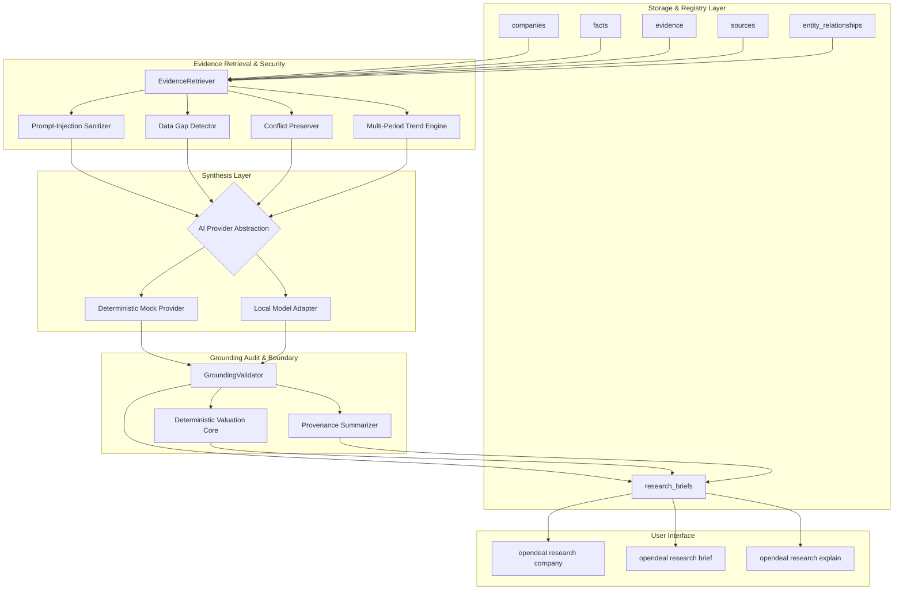
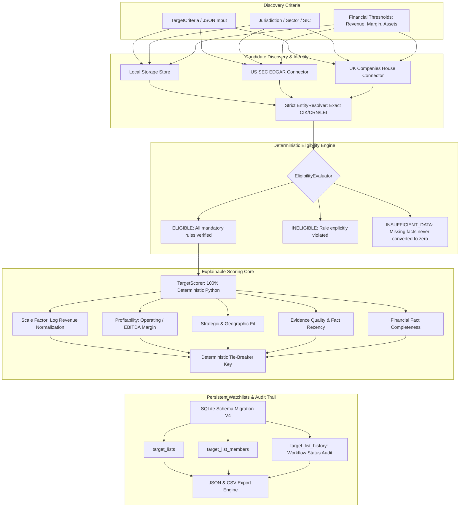
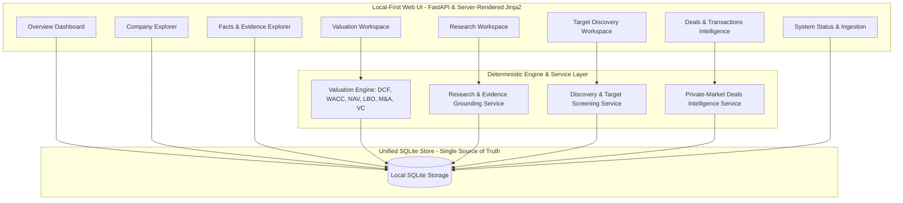

# OpenDeal

OpenDeal is an open-source, local-first, modular platform for private-market intelligence, corporate research, deterministic financial valuation, and deal sourcing.

---

## Architecture Principles

1. **Primary Source Grounding:** Financial facts originate strictly from official regulatory filings (SEC EDGAR, UK Companies House, official stock exchanges, central banks). Never fabricate estimates or substitute zeroes for missing disclosures.
2. **Deterministic Financial Math:** Quantitative valuation formulas (DCF, WACC, Multiples, NAV, LBO, M&A Accretion/Dilution, Monte Carlo, Venture Capital) execute deterministically in audited Python engines and sandbox workbooks, strictly decoupled from qualitative AI synthesis.
3. **Immutable Provenance:** Every fact retains full provenance—source URI, document ID, page, timestamp, excerpt, and SHA-256 cryptographic content hash.
4. **Epistemic Knowledge Tiers:** Factual claims are rigorously partitioned into 5 explicit tiers:
   - `SOURCE_REPORTED_FACT`: Direct assertions backed by verifiable primary filing citations.
   - `DERIVED_CALCULATION`: Deterministic formulas computed by reproducible code.
   - `ANALYST_ASSUMPTION`: Explicitly labeled model inputs (e.g. exit multiple, discount rate), never disguised as fact.
   - `AI_INTERPRETATION`: Qualitative analytical commentary bounded by evidence.
   - `MISSING_OR_CONFLICTING`: Systematically identified gaps and preserved contradictions.
5. **Local-First & Modest Hardware Feasibility:** Designed to run efficiently on standard consumer hardware (e.g. Apple Silicon M-series with 8 GB RAM) without requiring paid APIs or remote GPUs.
6. **Privacy & Security Defenses:** Untrusted documents are pre-sanitized against adversarial prompt-injection attacks. External network requests remain disabled by default; local models are strictly restricted to loopback interfaces.

---

## Intelligence & Research Architecture (Phase 5)



---

## Research Workflow

1. **Context Assembly:** When researching an entity, `EvidenceRetriever` aggregates all legal identifiers, relationships, facts, and primary evidence records.
2. **Defensive Pre-Processing:** Verbatim text excerpts are scanned and sanitized to neutralize adversarial prompt-injection payloads (e.g., instructions attempting to override policies or delete tables).
3. **Deterministic Trend & Gap Computation:** The system computes historical CAGRs (if periods are comparable in currency and accounting standard) and flags essential metric omissions (e.g., missing operating cash flow or liabilities).
4. **Epistemic Synthesis:** The AI provider generates candidate assertions, tagged by knowledge tier.
5. **Grounding Audit:** `GroundingValidator` verifies that every factual assertion links to real, target-scoped evidence in the database. Hallucinated IDs or cross-entity citations are rejected with confidence score `0.0`.
6. **Reproducible Archival:** Briefs are persisted to `research_briefs` for offline audit and historical tracking.

---

## Model Providers & Privacy Controls

OpenDeal isolates AI models behind the `AIProvider` contract (`src/opendeal/research/providers/`):
- `DeterministicMockProvider`: Generates reproducible, grounded outputs for offline test execution and zero-network workflows.
- `LocalModelProvider`: Connects to self-hosted runtimes (e.g. Ollama, llama.cpp, mlx-lm). Enforces loopback addresses (`127.0.0.1`, `localhost`) to prevent leaking private company data. External calls are disabled by default.

---

## Command-Line Interface (CLI)

```bash
# Generate or inspect comprehensive research intelligence
opendeal research company AAPL
opendeal research company AAPL --json

# Generate structured research brief with custom scope
opendeal research brief AAPL --no-valuations
opendeal research brief AAPL --json

# Audit claim-level evidence citations and cryptographic hashes
opendeal research explain <research_id>
opendeal research explain <research_id> --json
```

### Example CLI Output
```
=== OpenDeal Company Research Brief ===
Research ID:     rb_29dca358e3f9
Entity:          Apple Inc. (ent_8e81c51d2c60)
Status:          COMPLETED
Model Provider:  deterministic_mock
Generated At:    2026-10-18T12:56:15.621385+00:00

Executive Summary:
Research brief for Apple Inc. (US-CA). Analysis established 8 canonical facts and 8 primary evidence records. Disclosed financial filings and relationships have been verified with zero fabricated figures. Identified 5 operational data gaps.

--- Evidence-Grounded Claims ---
1. [VERIFIED] <SOURCE_REPORTED_FACT> Apple Inc. is an active corporate entity registered in jurisdiction US-CA. (Citations: ev_5456d613f069)
2. [VERIFIED] <SOURCE_REPORTED_FACT> Reported revenue of 383,285,000,000.00 USD for period ANNUAL in official filings. (Citations: ev_c250f0c2215b)
3. [VERIFIED] <DERIVED_CALCULATION> Deterministic revenue expansion of 80.8% calculated between base period and latest period. (Citations: ev_c8434756d68d, ev_c250f0c2215b)
4. [UNVERIFIED] <ANALYST_ASSUMPTION> Baseline valuation assumption models a normalized long-term GDP terminal growth rate of 2.0%.
5. [VERIFIED] <AI_INTERPRETATION> Operational filings reflect consistent revenue reporting discipline across the analyzed historical windows. (Citations: ev_5456d613f069)
6. [VERIFIED] <MISSING_OR_CONFLICTING> Data limitation noted: Total Liabilities is currently unrecorded in accessible registry filings.

--- Identified Data Gaps ---
• [MEDIUM] Total Liabilities: No verified observations of Total Liabilities found in primary filings.
• [HIGH] Operating Cash Flow: No verified observations of Operating Cash Flow found in primary filings.
• [MEDIUM] EBITDA / Operating Profit: No verified observations of EBITDA / Operating Profit found in primary filings.
• [LOW] Incorporation Date: Official incorporation date is unrecorded.
• [MEDIUM] Corporate Hierarchy: No parent, subsidiary, or ultimate beneficial owner relationships recorded.

--- Risk Indicators ---
• [Evidence-Backed] [MEDIUM] Missing disclosure for Total Liabilities impedes complete debt service audit. (Cites: ev_5456d613f069)
• [Analyst Assumption] [LOW] Macroeconomic inflation risks could compress margins (analyst model assumption).

--- Provenance & Integrity ---
Cited Evidence Records: 3
Primary Publishers:     US Securities and Exchange Commission (SEC EDGAR)
Source Integrity:       CRYPTOGRAPHICALLY_VERIFIED
```

---

## Deal Sourcing & Target Discovery (Phase 6)

OpenDeal includes a connector-neutral, evidence-grounded deal sourcing and target discovery engine (`src/opendeal/discovery/`).

### Target Discovery Architecture



### Key Principles & Guarantees

1. **No Silent Zero Fallbacks:** A missing financial observation never qualifies as meeting a threshold, nor is it converted to zero. It produces an explicit `INSUFFICIENT_DATA` outcome with detailed rationale.
2. **Separation of Eligibility and Ranking:** Mandatory screening requirements determine eligibility (`ELIGIBLE`, `INELIGIBLE`, `INSUFFICIENT_DATA`). Ranking preferences are computed only for eligible candidates.
3. **Deterministic Python Arithmetic:** Scoring is 100% reproducible across identical inputs, configurations, and data snapshots. AI never calculates or alters numeric scores.
4. **Machine-Readable Factor Breakdowns:** Every score discloses raw values, normalized contributions (0-1), weights, missing status, and configurable missing-data penalties.
5. **Strict Provenance & Deduplication:** Candidates from multiple sources are deduplicated strictly by verified legal identifiers (CIK, CRN, LEI), never by name similarity alone.
6. **Audited Target Watchlists:** Target lists track investment statuses (`NEW`, `RESEARCHING`, `SHORTLISTED`, `REJECTED`, `ON_HOLD`) with immutable transition histories and deterministic JSON/CSV export.

### CLI Sourcing Commands

```bash
# Deterministically screen targets across indexed sources
opendeal targets screen --jurisdiction US --min-revenue 10000000 --format table
opendeal targets screen --criteria criteria.json --format json

# Retrieve a past discovery screening run
opendeal targets run <run_id>

# Inspect detailed eligibility decision and factor score breakdown
opendeal targets explain <entity_id>

# List all saved watchlists
opendeal targets lists

# Target list management
opendeal targets list create "B2B SaaS 2026" -d "B2B SaaS acquisition targets"
opendeal targets list add <list_id> <entity_id> --status SHORTLISTED --note "Strong gross margin"
opendeal targets list show <list_id>
opendeal targets list remove <list_id> <entity_id>

# Export target list to JSON or CSV
opendeal targets export <list_id> --format csv -o targets.csv
opendeal targets export <list_id> --format json -o targets.json
```

---

## Private-Market Relationships, Funding & Transaction Intelligence (Phase 7)

OpenDeal provides an evidence-grounded private-market intelligence layer for corporate relationships, investors, funding rounds, acquisitions, exits, and transaction histories.

```mermaid
flowchart TD
    subgraph Storage [Relational Deal Storage - SQLite V5]
        FR[funding_rounds]
        FP[funding_participants]
        TX[transactions]
        DC[deal_conflicts]
        ER[entity_relationships]
    end

    subgraph Service [Intelligence & Traversal Services]
        DIS[DealsIntelligenceService]
        REC[EventReconciler]
        GRA[RelationshipGraphEngine]
    end

    subgraph Boundaries [Grounding & Epistemic Safeguards]
        UND[Undisclosed Values = None (Never 0)]
        CON[Conflict Preserver (No Silent Overwrite)]
        CYC[Cycle-Safe & Bounded Traversal]
        PROV[Source Provenance & Hash Citation]
    end

    subgraph CLI [Deals CLI Interface]
        C1[opendeal deals company]
        C2[opendeal deals funding]
        C3[opendeal deals acquisitions]
        C4[opendeal deals event]
        C5[opendeal deals investors]
        C6[opendeal deals timeline]
        C7[opendeal deals explain]
        C8[opendeal deals search]
        C9[opendeal deals ingest]
    end

    FR & FP & TX & DC & ER --> DIS
    DIS --> REC & GRA
    REC & GRA --> UND & CON & CYC & PROV
    UND & CON & CYC & PROV --> C1 & C2 & C3 & C4 & C5 & C6 & C7 & C8 & C9
```

### Key Principles & Guarantees

1. **Explicit Missing Disclosures:** Undisclosed deal considerations or round valuations strictly remain `None`. They are never defaulted to `0.0` or converted to zero.
2. **Entity & Vehicle Disambiguation:** Strictly separates legal entities from trade brands, investor organizations from investment fund vehicles, and parent corporate groups from portfolio operating entities.
3. **Transaction Status Fidelity:** Distinguishes `RUMORED`, `ANNOUNCED`, `PENDING`, `COMPLETED`, `TERMINATED`, `WITHDRAWN`, and `UNKNOWN`. Deals are never marked completed merely because they were announced or approved.
4. **Deterministic Event Reconciliation:** Repeated source observations matching strong identifiers are reconciled without duplicate records. Conflicting amounts, currencies, statuses, or counterparties produce persistent `DealConflict` records without silent overwrites.
5. **Cycle-Safe & Bounded Graph Traversal:** Traversal enforces bounded recursion (`max_depth=3` default) and visited-node cycle detection, preventing infinite path explosions.
6. **Offline-Default Ingestion:** Tests and standard operations execute offline with zero network requests. Live connector ingestion requires explicit `--live` opt-in.

### CLI Deals Commands

```bash
# Company deals overview (funding, acquisitions, key investors, conflicts)
opendeal deals company ent_apex_001
opendeal deals company ent_apex_001 --format json

# Documented funding rounds and financing events
opendeal deals funding ent_apex_001

# Documented M&A and corporate transaction history
opendeal deals acquisitions ent_apex_001
opendeal deals acquisitions ent_apex_001 --role seller

# Specific funding round or transaction event details
opendeal deals event rnd_apex_seed
opendeal deals event tx_titan_apex_acq

# Documented investors, funds, and syndicate relationships
opendeal deals investors ent_apex_001

# Deterministic chronological transaction timeline
opendeal deals timeline ent_apex_001

# Explain event provenance, missing fields, and source conflicts
opendeal deals explain rnd_apex_series_a

# Search funding rounds and transactions across the database
opendeal deals search --type all --limit 20
opendeal deals search --type funding --query Apex

# Ingest deals from offline fixture file
opendeal deals ingest fixture --file tests/fixtures/deals/sample_funding_and_transactions.json

# Live connector ingestion (requires explicit opt-in)
opendeal deals ingest sec --live --entity-id ent_apex_001
```

---

## Full Application UI, Dashboard & User Workflows (Phase 8)

OpenDeal provides an institutional, local-first web interface that unifies all capabilities implemented across Phases 1–7 into a single cohesive workflow.



### Launching the Web UI

Launch the local web server with loopback binding:
```bash
# Standard launch (binds to http://127.0.0.1:8000)
opendeal ui

# Custom port or development mode with hot-reloading
opendeal ui --port 8080 --reload

# Custom SQLite database path
opendeal ui --db-path /path/to/opendeal.db
```

### UI Features & Workflows

1. **Overview Dashboard (`/`):**
   - Live metrics derived strictly from local SQLite storage (Entity counts, Facts, Funding rounds, M&A transactions, Discovery runs, Target lists).
   - Instant quick-search bar and rapid action shortcuts.
   - Recent deal intelligence feed with transaction dates and counterparties.

2. **Company & Entity Explorer (`/companies`):**
   - Full-text search and jurisdiction filtering across all indexed corporate entities.
   - Company Dossier page with legal identifiers (CIK, CRN, LEI, Tickers), documented subsidiaries/relationships, verified facts, and connected transaction history.

3. **Financial Facts & Evidence Explorer (`/facts`):**
   - Granular tabular view of source-reported vs. derived metrics.
   - Knowledge tier badges (`SOURCE_REPORTED_FACT`, `DERIVED_CALCULATION`, `ANALYST_ASSUMPTION`, etc.).
   - Full evidence provenance inspection (`/facts/evidence/{evidence_id}`) showing document locator, verbatim text extract, and cryptographic SHA-256 payload hash.

4. **Deterministic Valuation Workspace (`/valuation`):**
   - Direct integration with OpenDeal's deterministic valuation engine.
   - Interactive calculation forms for **DCF**, **WACC**, **Gordon Growth**, **Net Asset Value (NAV)**, **Comparable Multiples**, **Sensitivity Matrix**, **LBO Model**, **M&A Accretion/Dilution**, **Monte Carlo Simulation**, and **Venture Capital Method**.
   - Input validation preserving missing values (never defaulting to zero).
   - Side-by-side display of computed outputs, engine warnings, sensitivity tables, and input assumptions.

5. **AI Research Workspace (`/research`):**
   - Company research brief generator integrating the Phase 5 evidence retriever and grounding validator.
   - Strict citation checking rejecting ungrounded claims.
   - Visual inspection of evidence references, identified data gaps, and multi-period financial trends.

6. **Target Discovery & Watchlists (`/discovery`):**
   - Deterministic acquisition screening against custom criteria (revenue thresholds, profitability, jurisdiction, industry keywords).
   - Clear rank ordering, composite scoring, factor breakdowns (`scale`, `profitability`, `fit`), and penalty disclosures.
   - Detailed gate failure explanations for excluded candidates.
   - Target list / watchlist management tracking deal pipeline stages (`NEW`, `RESEARCHING`, `SHORTLISTED`, `REJECTED`, `ON_HOLD`).

7. **Deals & Transaction Intelligence (`/deals`):**
   - Funding history explorer with round series, amounts, post-money valuations, and participant investors.
   - M&A and divestiture transaction logs with deal structures (asset purchase vs. stock sale, consideration mix).
   - Chronological company deal timeline (`/deals/timeline/{entity_id}`).
   - Conflict resolution viewer (`/deals/conflicts`) showing competing observations across external sources.

8. **System Health & Ingestion (`/system/status`, `/system/ingest`):**
   - Database health metrics, table row counts, and schema migration level.
   - Golden Master PEAK workbook SHA-256 verification status.
   - Secure offline fixture ingestion with path traversal defenses.
   - Clear safeguards requiring explicit two-step user confirmation before any live connector operation.

9. **Autonomous Workflows & Orchestration (`/workflows`):**
   - Workflow blueprint catalogue displaying required permissions, version, and execution parameters.
   - Run launch configuration form for triggering automated analyses.
   - Real-time run inspector detailing topological task execution, dependencies, and outputs.
   - Human-in-the-loop approval queue (`/workflows/approvals`) for gating privileged actions.
   - Interactive deterministic workflow planner (`/workflows/planner`) converting natural language into validated execution proposals.

---

## Autonomous Agents & Workflow Orchestration (Phase 9)

OpenDeal provides an institutional, local-first agent framework that orchestrates research, valuation, screening, and transaction intelligence into repeatable, inspectable workflows.

```mermaid
flowchart TD
    subgraph UI_CLI [Interfaces]
        CLI[opendeal workflow]
        WEB[/workflows]
    end

    subgraph Runtime [Workflow Engine]
        PLAN[Deterministic Planner]
        POL[Policy & Permission Engine]
        RUN[Topological Runner]
        APPR[Approval Manager]
        AUD[Audit Inspector]
    end

    subgraph Agents [Specialized Agents]
        A1[evidence_data_quality_agent]
        A2[company_research_agent]
        A3[target_discovery_agent]
        A4[deal_intelligence_agent]
        A5[valuation_preparation_agent]
    end

    subgraph Storage [Persistent State - MIGRATION_V6]
        DB[(opendeal.db)]
    end

    UI_CLI --> PLAN & RUN & APPR & AUD
    RUN --> POL
    POL --> APPR
    RUN --> Agents
    Agents --> Storage
    RUN --> Storage
```

### Specialized Agents

- **`evidence_data_quality_agent`:** Scans local facts and evidence references for missing fields, period inconsistencies, currency mismatches, and broken citations. Emits non-destructive remediation reports.
- **`company_research_agent`:** Retrieves primary evidence and synthesizes grounded research briefs via audited providers. Rigorously segregates knowledge into epistemic tiers.
- **`target_discovery_agent`:** Executes deterministic eligibility checks and multi-factor scoring for candidate targets. Discloses factor contributions and gate exclusions.
- **`deal_intelligence_agent`:** Assembles chronological corporate funding and M&A timelines. Identifies competing external deal observations without guessing undisclosed values.
- **`valuation_preparation_agent`:** Assembles financial facts and analyst assumptions, checks model completeness, and invokes the deterministic mathematical valuation engine (`calculate_dcf`, `calculate_wacc`).

### Standard Workflow Blueprints

1. **Company Intelligence Dossier (`wf_company_dossier`):** Resolves entity, runs data-quality checks, aggregates deals & timeline, and generates a grounded research brief.
2. **Acquisition Target Screening (`wf_target_screening`):** Evaluates eligibility criteria, computes composite scores, explains exclusions, and generates a candidate shortlist.
3. **Valuation Readiness and Analysis (`wf_valuation_analysis`):** Validates reporting periods and currencies, inspects required DCF parameters, and computes deterministic equity value.
4. **Deal Event Monitoring (`wf_deal_monitoring`):** Compares local records against recorded snapshots to detect newly ingested funding rounds, transactions, and status changes.
5. **Data Integrity Audit (`wf_data_integrity_audit`):** Scans the local database for orphaned evidence citations and contradictory observations.

### CLI Workflow Management

```bash
# List registered workflow blueprints
opendeal workflow list

# Execute a workflow
opendeal workflow run wf_company_dossier --input '{"entity_id": "ent_acme_corp"}'
opendeal workflow run wf_data_integrity_audit

# Inspect workflow run status and task outputs
opendeal workflow status <run_id>

# View chronological audit trail with secret redaction
opendeal workflow audit <run_id>

# List and decide pending human approval requests
opendeal workflow pending
opendeal workflow approve <approval_id> --decision approve --reason "Analyst reviewed"
opendeal workflow approve <approval_id> --decision reject --reason "Scope too broad"

# Cancel an active workflow run
opendeal workflow cancel <run_id>

# Propose an automated workflow plan from natural language
opendeal workflow plan "Screen SaaS targets with ARR > 10M"
```

---

---

## Security Hardening & Acceptance Controls (Phase 10)

OpenDeal incorporates institutional-grade defensive controls:
- **Loopback Enforcement:** Binds strictly to `127.0.0.1` by default; binding to external interfaces requires the `--allow-remote` CLI flag.
- **DNS Rebinding & Host Validation:** Middleware strictly validates `Host` authority and rejects malformed host headers.
- **Atomic Approval Consumption:** Privileged actions transition approvals from `APPROVED` to `CONSUMED` atomically, preventing replay or double-execution under concurrency.
- **Filesystem & Path Traversal Guards:** Fixture ingestion and valuation sandbox directories enforce strict root-confinement (`is_relative_to`) and reject parent path tokens (`..`).
- **Terminal Record Immutability:** Terminal workflow runs (`COMPLETED`, `FAILED`, `CANCELLED`, `TIMED_OUT`) and task runs are strictly immutable in the persistence layer. Any attempt to mutate states or outputs is rejected by atomic SQL predicates.
- **Secret Redaction:** Chronological audit trails recursively sanitize nested dictionaries, credential arrays, Bearer tokens, and private keys.
- **Resource Bounds:** Enforces maximum task counts, DAG dependency depth limits, streaming request body size limits (10 MB with HTTP 413), and workflow duration timeouts.

---

## Operator & Release Engineering Guide (Phase 11)

### 1. Supported Environments & Prerequisites
- **Python:** 3.9, 3.10, 3.11, 3.12 (standard CPython).
- **Operating Systems:** macOS (including Apple Silicon M1/M2/M3 with 8 GB RAM) and Linux (Ubuntu 20.04+, Debian 11+).
- **Hardware Requirement:** 8 GB RAM, 2 GB disk space. Standard consumer laptops are fully supported development and deployment targets.
- **Zero Cloud Lock-In:** No paid APIs, no mandatory cloud accounts, and no proprietary model downloads are required for core operations.

### 2. Clean Environment Installation

#### Option A: From Pre-Built Release Wheel (Recommended)
```bash
python3 -m venv opendeal-env
source opendeal-env/bin/activate
pip install --upgrade pip
pip install dist/opendeal-0.11.0rc1-py3-none-any.whl
```

#### Option B: Editable Developer Installation from Source
```bash
python3 -m venv opendeal-env
source opendeal-env/bin/activate
pip install --upgrade pip setuptools wheel
pip install -e .[dev]
```

### 3. CLI Quickstart & Core Workflows

Once installed, the `opendeal` command is globally available in your virtual environment:

```bash
# Check platform operational status and database connection
opendeal status
opendeal status --json

# Search and resolve companies
opendeal company search "Apple"
opendeal company show AAPL

# Run deterministic valuation engines
opendeal value dcf AAPL --discount-rate 0.085 --terminal-growth 0.025
opendeal value lbo --help
opendeal value monte-carlo --help

# Workflow orchestration & autonomous agent blueprints
opendeal workflow list
opendeal workflow run wf_company_dossier --input '{"entity_id": "AAPL"}'
opendeal workflow pending
```

### 4. Safe Local UI Operation

OpenDeal provides an institutional web interface designed strictly for single-operator local use:

```bash
# Start local UI on default loopback interface (http://127.0.0.1:8000)
opendeal ui --port 8000

# Specify a custom database location
opendeal ui --db-path /path/to/custom_opendeal.db --port 8080

# Graceful Shutdown
# Press Ctrl+C (SIGINT) or send SIGTERM to cleanly terminate the server.
```

> [!WARNING]
> By default, binding to any non-loopback host (e.g. `0.0.0.0` or public IP) is rejected with exit code 1. Binding to external networks requires explicit operator authorization via `--allow-remote`. Never expose the unauthenticated local UI to the public internet.

### 5. Database Management, Backup, Restore & Migrations

OpenDeal uses SQLite with WAL mode, busy timeouts, and incremental schema migrations (`001_initial_schema` through `006_workflow_orchestration`).

- **Database Location:** Defaults to `opendeal.db` in current directory, or configured via `OPENDEAL_STORAGE__DATABASE_PATH` / `OPENDEAL_DATABASE_PATH`.
- **Automatic Migration:** Opening the database automatically applies pending migrations in numerical sequence and records them in `schema_migrations`.
- **Hot Backup (Zero-Downtime):**
  ```bash
  sqlite3 opendeal.db ".backup 'opendeal_backup_$(date +%Y%m%d_%H%M%S).db'"
  ```
- **Restore:**
  1. Stop any running `opendeal ui` or workflow processes.
  2. Replace the active file:
     ```bash
     cp opendeal_backup_20261018.db opendeal.db
     ```
  3. Re-run `opendeal status` to verify integrity.

### 6. Configuration & Optional Integrations

Configuration is managed via environment variables (prefixed with `OPENDEAL_`) or a local `.env` file (template available at `.env.example`):

- `OPENDEAL_ENVIRONMENT`: `production` or `development`.
- `OPENDEAL_STORAGE__DATABASE_PATH`: Custom path to SQLite database.
- `OPENDEAL_SEC__USER_AGENT`: SEC EDGAR user agent header (e.g. `"OpenDealPlatform admin@example.com"`).
- `OPENDEAL_COMPANIES_HOUSE__API_KEY`: Optional UK Companies House REST API key.

### 7. Offline Defaults vs. Network-Dependent Features

- **Offline-First (Default):** All valuation models, workflow planning, fact standardization, conflict detection, screening, and mock AI brief generation operate completely offline with zero network connectivity.
- **Opt-In Network Features:** Live filings retrieval via `opendeal ingest sec` or `opendeal ingest companies-house` requires network connectivity and compliance with rate-limiting policies.

### 8. Security Boundaries & Single-Operator Trust Model

- **Single-Operator Workstation:** OpenDeal is architected as an analyst workstation tool. It does not provide multi-tenant authentication, password hashing, or role-based user isolation.
- **Terminal Immutability:** Once a task or workflow reaches a terminal state (`COMPLETED`, `FAILED`, `CANCELLED`, `TIMED_OUT`), it cannot be overwritten, re-executed, or altered.
- **Approval Tokens:** Privileged actions generate cryptographic approval payloads; approvals expire and can only be consumed once.

### 9. Troubleshooting Common Errors

- **Port in Use:** `Error: Port 8000 on 127.0.0.1 is already in use by another process.`
  - *Fix:* Specify a different port: `opendeal ui --port 8081`.
- **Security Policy Rejection on Bind:** `Security Policy Rejection: Binding to non-loopback interface '0.0.0.0' requires the '--allow-remote' flag.`
  - *Fix:* Bind to `127.0.0.1` (recommended) or pass `--allow-remote` if on a private VPN.
- **SEC EDGAR User Agent Rejected:** `ValueError: SEC requires a descriptive User-Agent including an email address.`
  - *Fix:* Set `OPENDEAL_SEC__USER_AGENT="YourApp/1.0 yourname@yourdomain.com"` in `.env`.

### 10. Building & Validating Release Artifacts

To produce distributable wheel and sdist packages:
```bash
python3 -m pip install build
python3 -m build --sdist --wheel --outdir dist/

# Verify artifact checksums
python3 -c "
import glob, hashlib
for f in sorted(glob.glob('dist/*')):
    print(f, hashlib.sha256(open(f, 'rb').read()).hexdigest())
"
```

### 11. Upgrading from Prior Releases
1. Create a verified backup of your SQLite database.
2. Upgrade the installed package via pip: `pip install --upgrade dist/opendeal-<version>-py3-none-any.whl`.
3. Run `opendeal status` to trigger and verify incremental schema migrations.

### 12. Known Limitations & Unverified Claims
- **No Remote Multi-User Authentication:** OpenDeal does NOT implement enterprise multi-user session management or internet-facing access control. Do not host on the public internet without an authenticating reverse proxy (e.g. Tailscale, Cloudflare Access, or NGINX with OAuth2).
- **Remote CI:** GitHub Actions workflows are provided (`.github/workflows/ci.yml`) and validated locally, but execution on remote GitHub runners remains unverified until deployed to a remote Git host.

---

## Development & Test Execution

Run the complete test suite with coverage:
```bash
pytest --cov=opendeal --cov-report=term-missing
```

Verify protected PEAK golden master workbook immutability:
```bash
python3 -c "import hashlib; assert hashlib.sha256(open('/Users/uday/Documents/uday_projects/tester1/PEAK_Ultimate_Institutional_Valuation_System_FIXED.xlsx', 'rb').read()).hexdigest() == 'ae2343527fb355ae7454f3fd4354289ff51ced8f5a2a8e62aac0ec0675bcbfa5'"
```


