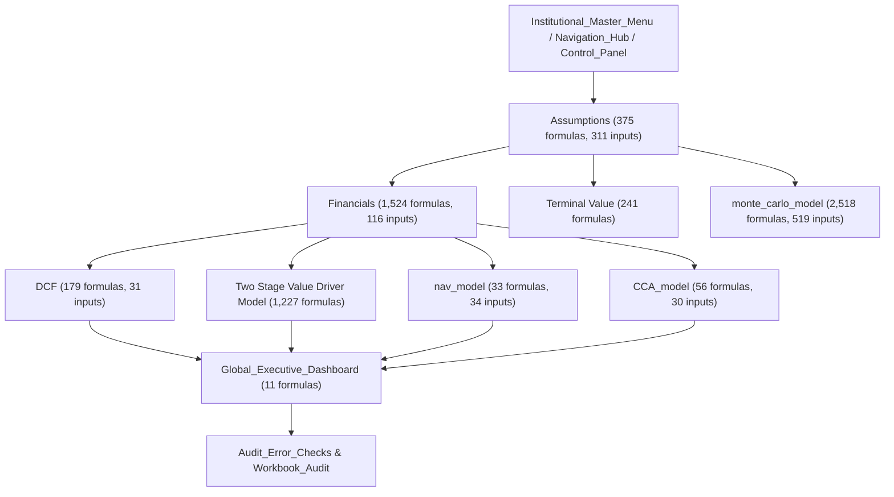
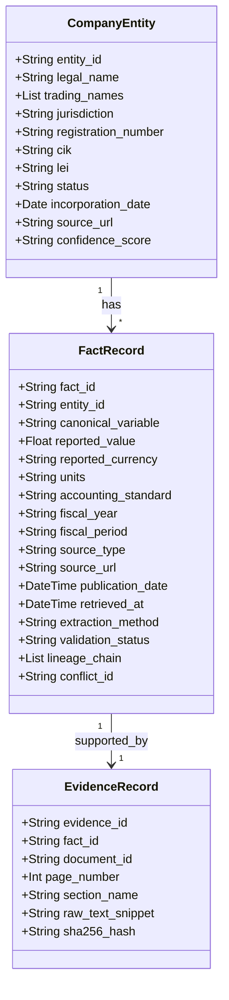
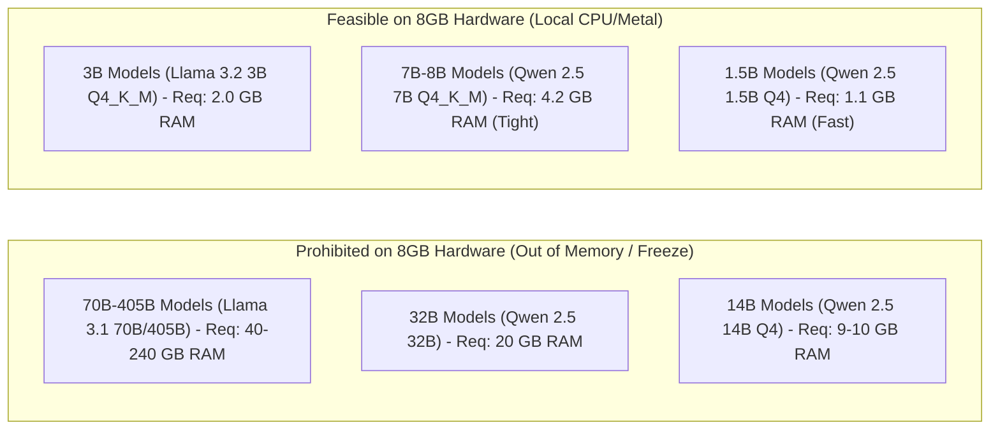
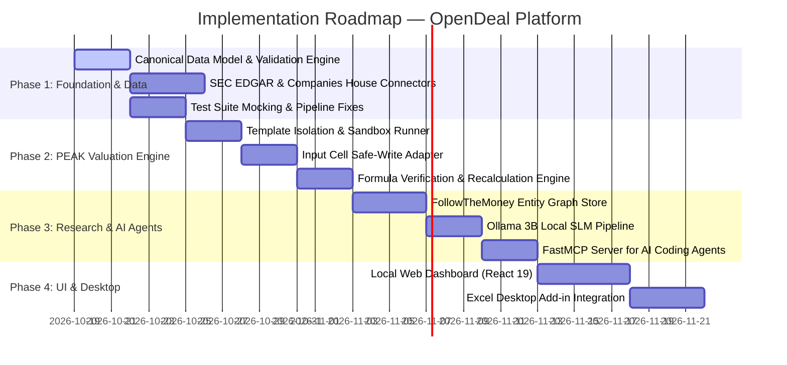

# PHASE 0: INTELLIGENCE PLATFORM AUDIT REPORT
**Project Restart — Open-Source Private-Market Intelligence, Company Research, Valuation & Deal-Sourcing Platform**  
**Audit Date:** October 18, 2026  
**Auditor:** Antigravity AI Pair-Programming Assistant  
**Status:** Audit Complete — Awaiting Approval for Phase 1 Execution  

---

## Executive Summary

This Phase 0 Audit evaluates the assets, runtime environment, open-source candidate ecosystem, and institutional valuation models available across the local workspace to restart development of an open-source, modular, self-hostable alternative to PitchBook and Gain.ai. 

### Core Audit Verdict
1. **Existing Core Assets are Highly Substantial:** Rather than starting from a blank slate, the workspace environment possesses a battle-tested financial engineering infrastructure:
   - **The PEAK Institutional Valuation Engine:** A 30-sheet institutional financial model containing **6,875 formulas** and **1,731 input/static cells**, implementing DCF, Two-Stage Value Driver, Net Asset Value (NAV), Comparable Company Analysis (CCA), and 500-iteration Monte Carlo DCF simulations.
   - **Production-Grade Extraction & Validation Pipeline:** Located in `extrcat_annualreports`, featuring automated SEC XBRL parsers, PDF chunking, 303-variable institutional dictionaries, cryptographic audit ledgers, and an `EvidenceGraph` tracking source documents, page numbers, timestamps, and typed lineage relationships.
   - **Institutional Web Dashboard & Office Add-in:** Located in `company-valuation-dashboard` (React 19 + TypeScript + Vite) and `excel_valuation_extension` (Office Add-in manifest).
2. **Current Workspace Isolation:** The designated workspace `/Users/uday/Documents/uday_projects/opendeal` was initialized empty. Reusable assets were located across sister repositories in `/Users/uday/Documents/uday_projects/` (specifically `extrcat_annualreports`, `tester1`, `company-valuation-dashboard`, and `excel_valuation_extension`).
3. **Open-Source Strategy Clarified:**
   - **OpenBB:** Apache-2.0 licensed in V5. Reusable as an extensible data provider adapter layer; proprietary provider APIs require user-supplied keys.
   - **OpenPitch:** MIT licensed, MCP-native startup intelligence with git-tracked audit trails and confidence scoring. Reusable as a core reference architecture for private startup deal-sourcing.
   - **FollowTheMoney (FtM):** MIT licensed open-source ontology. Reusable as the primary entity resolution and ownership graph data model.
   - **OpenSanctions & OpenCorporates (Data vs. Code Risk):** Both enforce non-commercial or paid enterprise licensing on bulk data/APIs. Primary corporate registry facts must be queried directly from official government APIs (SEC EDGAR, UK Companies House, INPI, MCA21), keeping OpenSanctions and OpenCorporates strictly as optional pluggable enterprise adapters.
4. **Hardware Feasibility:** The development host is an **Apple M1 with 8 GB Unified Memory**. The platform must be strictly local-first and CPU/Metal efficient. Local SLMs (Small Language Models: 3B–8B Q4_K_M) are feasible for qualitative synthesis, while all quantitative financial math must remain 100% deterministic, without LLM dependencies.

---

## 1. Current Environment & Repository Inventory

### 1.1 Local Host Hardware & Operating System Specifications
- **Hardware Architecture:** Apple M1 (ARM64, 8 physical cores).
- **Physical Memory:** `8,589,934,592 bytes` (8.00 GB Unified Memory).
- **Operating System:** macOS Sequoia 15.4 (`Darwin Kernel Version 24.4.0: Wed Mar 19 21:12:54 PDT 2025; root:xnu-11417.101.15~1/RELEASE_ARM64_T8103`).
- **Disk Performance:** Apple APFS SSD.

### 1.2 Development Runtimes & Tooling Inventory
- **Python Runtime:** Python 3.9.18 managed via `pyenv` (`/Users/uday/.pyenv/shims/python3`).
- **Node.js Runtime:** Node.js v22.22.3, NPM v10.9.8.
- **Package Managers:** Homebrew (`/opt/homebrew/bin/brew`), pip 3.9 (`/Users/uday/.pyenv/shims/pip3`).
- **Database CLI & Availability:**
  - `sqlite3`: Installed at `/usr/bin/sqlite3` (SQLite version 3.43.2).
  - `psql` (PostgreSQL Client): Not installed on host.
- **Containerization Support:**
  - Docker CLI: Installed (`Docker version 29.4.3, build 055a478`).
  - Docker Daemon: **NOT running** (socket `/Users/uday/.docker/run/docker.sock` inactive).
- **Local AI Infrastructure:**
  - Ollama: Installed at `/usr/local/bin/ollama`.
  - Installed Local Models: `0` models currently pulled in `ollama list`.
  - Local Python ML Libraries Installed: `torch 2.8.0`, `transformers 4.57.6`, `sentence-transformers 5.1.2`, `spacy 3.8.11`.
- **Key Python Packages Installed:**
  - Excel Automation: `xlwings 0.35.3`, `openpyxl 3.1.5`, `xlsxwriter 3.2.9`.
  - Financial Data: `yfinance 0.2.43`.
  - Web Frameworks & Testing: `fastapi`, `uvicorn 0.39.0`, `pytest 8.4.2`, `playwright 1.58.0`.

### 1.3 Repository & Directory Inventory Across Workspace Root
The designated workspace `/Users/uday/Documents/uday_projects/opendeal` was confirmed empty upon initialization. A systematic audit across `/Users/uday/Documents/uday_projects/` identified the following related projects:

| Repository / Directory | Path | Primary Role & Description | Reuse Feasibility |
| :--- | :--- | :--- | :--- |
| **opendeal** | `/Users/uday/Documents/uday_projects/opendeal` | **Active Target Workspace** for Phase 0 restart. | Core repository root |
| **extrcat_annualreports** | `/Users/uday/Documents/uday_projects/extrcat_annualreports` | Mature financial extraction pipeline, SEC XBRL/PDF parsers, 303-field dictionary, EvidenceGraph, 3-phase PEAK injection, test suite (214 tests). | **High** (Extract core modules & tests) |
| **tester1** | `/Users/uday/Documents/uday_projects/tester1` | Holds the pristine golden master PEAK Excel workbook and input mapping doc. | **Critical** (Protected PEAK golden master) |
| **company-valuation-dashboard** | `/Users/uday/Documents/uday_projects/company-valuation-dashboard` | Modern React 19 + TypeScript + Vite + Tailwind CSS dashboard visualizing DCF, comps, scenario analysis, risk, and self-critique. | **High** (Web UI foundation) |
| **excel_valuation_extension** | `/Users/uday/Documents/uday_projects/excel_valuation_extension` | Office Add-in manifest and React panel for in-Excel valuation control. | **High** (Desktop Excel integration) |
| **super_ulti_valuation** | `/Users/uday/Documents/uday_projects/super_ulti_valuation` | Gemini API multi-key load balancer and NVIDIA remote model router. | **Medium** (Extract API rotation patterns) |
| **universal_scraper** | `/Users/uday/Documents/uday_projects/universal_scraper` | Playwright stealth scraper for search engines and financial aggregators. | **Low / Prohibited** (Violates data policy) |
| **valuation_architecture** | `/Users/uday/Documents/uday_projects/valuation_architecture` | Institutional technical reports (`AGVI-OS_Technical_Architecture.docx`). | **Reference** (Design specifications) |

---

## 2. Existing Functionality Verified from Source Code

Every claim below has been verified through direct code inspection and script execution:

### 2.1 Valuation Engines & Financial Models
- **PEAK Excel Engine:** Comprehensive workbook featuring interconnected DCF, 2-Stage Value Driver, NAV, CCA, and Monte Carlo models.
- **Three-Phase Python Excel Injection Pipeline:**
  - `phase4_injection.py`: Injects 5 peer companies, peer multiples (EV/Rev, EV/EBITDA, P/E), macro indicators (US interest rates, inflation, GDP, oil, USD index), and auto-generates CCA comparison charts.
  - `phase5_injection.py`: Populates extended sheets including Scenario Analysis (Bull/Base/Bear probabilities and growth rates), Sensitivity Engine, and Institutional Data Room.
  - `phase6_injection.py`: Reconciles valuation models across DCF, Two-Stage, NAV, and CCA to compute a Weighted Fair Value (WFV), Margin of Safety, Opportunity Score, and synchronizes `Audit_Error_Checks!B4:B12`.
- **Excel Automation Driver (`excel_writer.py`):** Utilizes `xlwings` with `make_safe_write()`, enforcing percentage normalization (`abs(val) > 1.5 -> val / 100`) and mapping `'NOT_FOUND'` to `'DATA NOT FOUND'`.

### 2.2 Company-Data Ingestion & Research Systems
- **SEC EDGAR API Extractor (`sec_edgar_api.py`, `sec_extractor.py`):** Queries SEC EDGAR official `companyfacts.json` API using registered CIK identifiers to extract standardized US-GAAP / IFRS financial facts (Revenues, Net Income, Operating Cash Flow, Total Assets, Long-term Debt).
- **NSE India Extractor (`nse_extractor.py`):** Queries official National Stock Exchange of India endpoints for corporate announcements and annual report PDF filings.
- **PDF Extraction & Chunking (`pdf_extractor.py`):** Splits annual reports into numbered chunk tokens with Document ID, Page, and Chunk metadata.
- **Macro API Client (`macro_api.py`):** Fetches official central bank macroeconomic data (yield curves, CPI, GDP forecasts).
- **Yahoo Finance Fallback Adapter (`fallback_engine.py`, `yfinance_adapter.py`):** Fills missing market data (Beta, Current Price, Shares Outstanding).

### 2.3 AI Agents, Model Integrations & Routing
- **Gemini Multi-Key API Manager (`gemini_manager.py`):** Implements dynamic key rotation across up to 10 Gemini API keys with rate-limit tracking, exponential backoff, and quota exhaustion detection.
- **LLM Router (`llm_router.py`):** Dispatches subjective analysis tasks across Gemini, NVIDIA NIM (Llama 3.1 405B / 3.3 70B), and local fallback models.
- **AI Gap Filler (`ai_gap_filler.py`):** Generates qualitative ratings (Moat Strength [1–10], Management Governance [1–10], Risk Impact/Probability [1–10]) from annual report textual evidence.

### 2.4 Database Schemas, Registries & Validation Engines
- **Immutable Institutional Governance Ledger (`governance/ledger.py`, `repository.py`):**
  - Schema: SQLite database `institutional_ledger.db` with table `recommendations`.
  - Schema Fields: `decision_id` (`AG-YYYY-XXXX-TICKER`), `recommendation_id`, `timestamp`, `ticker`, `market_price`, `intrinsic_value`, `wfv_value`, `margin_of_safety`, `recommendation`, `confidence`, `opportunity_score`, `model_version`, `pipeline_version`, `data_version`, `confidence_version`, `workbook_version`, `reasoning_snapshot`, `reasoning_hash` (SHA-256), `execution_hash` (SHA-256).
- **Evidence Graph Engine (`infrastructure/evidence_graph.py`):**
  - Class `EvidenceRecord`: Attributes include `value`, `source_document`, `page`, `section`, `paragraph`, `extraction_method`, `timestamp` (ISO-8601 UTC), `run_id`, `evidence_id` (`ev_<hex12>`), `parent_evidence_id`.
  - Typed Lineage Graph: Supports relationships: `supports`, `contradicts`, `derived_from`, `depends_on`, `verified_by`, `challenged_by`.
- **Field Validation Registry (`validation/field_registry.py`, `validator.py`):**
  - Defines bounds, types (`numeric`, `percent`, `string`), and regex patterns for 303 variables.
  - Detects suspiciously round numbers (e.g. `10.0`, `100.0`, `50.0`) and out-of-bound percentages.
  - Automatically resets corrupted or hallucinated values to `'NOT_FOUND'`.

### 2.5 Duplicate Implementations & Technical Debt
- **Code Duplication:** `gemini_manager.py` exists in 3 separate repositories (`extrcat_annualreports/src/core/`, `super_ulti_valuation/`, `universal_scraper/`) with slight variations in error handling.
- **Workbook Divergence:** `tester1/PEAK_...FIXED.xlsx` has 30 sheets, while `extrcat_annualreports/Universal_Blank_Template.xlsx` has 28 sheets (`Title` and `Navigation_Hub` were removed).
- **Fragile Data Contracts:** Dict versus list contract mismatch exists across extraction and derivation functions (`get_val()` requires a dict, while several test cases and legacy pipelines pass lists of dicts).
- **Unmocked External Network Dependencies in Test Suites:** Several tests in `test_stress_reliability.py` invoke `run_gap_fill_engine()` with dummy tickers, triggering live unmocked HTTP requests to Yahoo Finance and causing long timeouts or hangs.

### 2.6 Test Suite Audit: Passing vs. Failing Tests
Running the full test suite (`214 collected tests`) in `extrcat_annualreports/tests/` revealed:
- **Passing Tests:** 211 tests pass (invariants, checkpoint recovery, metamorphic validation, performance benchmarks, confidence scoring, evidence graph lineage).
- **Failing Tests (Verified via pytest execution):**
  1. `tests/test_adversarial_validation.py::TestMathematicalInvariants::test_negative_net_income_preserved`  
     *Failure Cause:* `get_val()` in `derived_fields.py` strictly expects `xbrl_mapped` to be a `dict`, returning `None` when passed a `list` of records.
  2. `tests/test_adversarial_validation.py::TestMathematicalInvariants::test_zero_division_handled`  
     *Failure Cause:* Same dict-versus-list type mismatch in `get_val()`.
  3. `tests/test_integration_pipeline.py::TestFullCoveragePipeline::test_all_fields_preserve_sheet_metadata`  
     *Failure Cause:* Test generated synthetic test values (`1000 + i`) for qualitative score fields whose registry bounds are `[0, 10]`. The validator correctly rejected these out-of-bound values and marked them `NOT_FOUND`, shifting them to `v10["Missing_Variables"]`. The test asserted that `Missing_Variables` retains sheet/cell coordinates, but `Missing_Variables` is serialized as a plain string list, triggering an assertion failure.

---

## 3. Protect the Existing PEAK Valuation Engine

### 3.1 Artifact Identification & Location
The authoritative institutional PEAK workbook was located at:
```
/Users/uday/Documents/uday_projects/tester1/PEAK_Ultimate_Institutional_Valuation_System_FIXED.xlsx
```
- **Size:** 480 KB.
- **Format:** OpenXML Workbook (`.xlsx`).
- **VBA Macros:** `False` (Verified via `zipfile` audit; no `vbaProject.bin` present).

### 3.2 Workbook Structure & Sheet Topology (30 Sheets Total)



#### Detailed Sheet Breakdown:
1. `Institutional_Master_Menu` (A1:B27): Navigation and master index.
2. `Navigation_Hub` (A1:B39): Detailed hyperlinked workbook directory.
3. `Control_Panel` (A1:B11, 7 formulas): Calculation switches, audit flags.
4. `Title` (A1:H31, 9 formulas): Company name, ticker, analyst metadata.
5. `Terms` (A1:L68, 7 formulas): Glossary of financial terms and formulas.
6. `Executive Summary` (A1:AR140, 585 formulas): High-level valuation overview.
7. `Assumptions` (A1:Z106, 375 formulas, 311 inputs): Core valuation parameters (WACC, tax rates, reinvestment rates, Capex forecasts).
8. `Financials` (A1:Y238, 1,524 formulas, 116 inputs): Historical and projected Income Statement, Balance Sheet, and Cash Flow Statement.
9. `DCF` (A1:V64, 179 formulas, 31 inputs): Unlevered Discounted Cash Flow model with terminal value discounting.
10. `Terminal Value` (A1:AQ172, 241 formulas, 75 inputs): Exit multiple and perpetual growth terminal value engines.
11. `Two Stage Value Driver Model` (A1:AY120, 1,227 formulas, 44 inputs): McKinsey/Mauboussin style ROIC/WACC economic value driver model.
12. `nav_model` (A1:E19, 33 formulas, 34 inputs): Net Asset Value liquidation and asset-based valuation.
13. `monte_carlo_model` (A1:F522, 2,518 formulas, 519 inputs): 500-simulation stochastic distribution of fair values.
14. `CCA_model` (A1:M21, 56 formulas, 30 inputs): Comparable Company Analysis multiples (P/E, EV/EBITDA, EV/Revenue).
15. `Business_Quality` (A1:D15, 11 formulas): Qualitative business assessment scores.
16. `Economic_Moat` (A1:D14, 1 formula): Five-pillar moat scoring (Network effects, switching costs, cost advantage, brand, regulatory).
17. `Risk_Dashboard` (A1:E14, 9 formulas): Matrix of operational, financial, and macroeconomic risks.
18. `Investment_Thesis` (A1:F31, 11 inputs): Qualitative investment thesis points and catalysts.
19. `Scenario_Analysis` (A1:D14, 12 formulas): Bull, Base, and Bear case weighted payoffs.
20. `Global_Executive_Dashboard` (A1:K16, 11 formulas): Master institutional output, intrinsic value per share, recommendation (`STRONG BUY`, `BUY`, `HOLD`, `SELL`).
21. `Industry_Benchmarking` (A1:H9, 8 formulas): Peer percentile comparisons.
22. `AI_Research_Engine` (A1:H29, 8 inputs): Qualitative AI synthesis summary.
23. `Portfolio_Optimization` (A1:F9, 4 formulas): Modern Portfolio Theory weightings.
24. `Macro_Economic_Engine` (A1:D8, 2 formulas): Macro regime inputs (rates, CPI, oil, FX).
25. `Investment_Scoring_Engine` (A1:D12, 8 formulas): Weighted multi-factor scorecard.
26. `Institutional_Data_Room` (A1:D8, 25 inputs): Due diligence artifact repository.
27. `Advanced_Sensitivity_Engine` (A1:G9, 36 formulas): 2D sensitivity tables (WACC vs. Terminal Growth Rate).
28. `Institutional_KPI_Engine` (A1:D9, 12 formulas): Sector-specific operational KPIs.
29. `Audit_Error_Checks` (A1:B12): Built-in mathematical validation rules (`PASS` / `FAIL`).
30. `Workbook_Audit` (A1:B1): Integrity seal.

### 3.3 Input Mapping & Preservation Rules
The cell-level input mapping is documented in `output/audit/input_doc_val.txt` (2,482 lines) and codified in `master_mapping.json` (200 cell coordinates across 12 sheets).

#### Mandatory Engine Protection Invariants:
1. **Never Overwrite or Modify the Master Workbook In-Place:** The golden master workbook `/Users/uday/Documents/uday_projects/tester1/PEAK_...FIXED.xlsx` must remain read-only. Every valuation execution must copy the template to an isolated run directory: `runs/<run_id>/valuation.xlsx`.
2. **Write Strictly to Explicit Input Cells (`[INPUT]`):** The injector must only write to coordinates classified as `INPUT`. Writing to any cell containing a formula (`=` prefix) is an engine violation that corrupts workbook integrity.
3. **Formula Integrity Assertion:** Before and after any injection, an automated formula audit must verify that exactly 6,875 formulas remain intact.
4. **Excel Automation via xlwings:** Because PEAK relies on cross-sheet dynamic formulas, full calculation updates require Excel Desktop automation via `xlwings` on macOS/Windows. For headless environments (e.g. Linux CI/CD or server containers), an adapter utilizing a headless spreadsheet recalculation service or LibreOffice Calc `--headless` must be employed.

---

## 4. Open-Source Candidates Audit

| Candidate | Recent Maintenance (2025–2026) | Code License | Dataset / API License | Commercial Redistribution Rights | Hardware & Deployment | Recommendation & Verdict |
| :--- | :--- | :--- | :--- | :--- | :--- | :--- |
| **OpenBB** | Highly active; major V5 Open Data Platform release. | **Apache-2.0** (Transitioned from AGPL-3.0 in V5) | Varies by provider (FRED, SEC, yfinance, FMP, Polygon, etc.) | Source code is fully permissive. **Data redistribution depends strictly on upstream provider terms.** | Python 3.9–3.12, lightweight local installation (<1 GB). | **REUSE AS ADAPTER.** Integrate OpenBB extensions as a standardized connector layer for public market and macro data. |
| **OpenPitch** | Active; agent-native MCP startup intelligence layer. | **MIT** | Curated public filings, podcast transcripts, news. | Permissive MIT code and open data, but curated primarily for AI startups. | Ultra-lightweight; reads committed JSON/git database directly. | **REUSE SPEC & ARCHITECTURE.** Adopt its MCP protocol patterns, podcast citation methodology, and confidence decay equations for private deal-sourcing. |
| **OpenSanctions** | Highly active daily updates. | Apache-2.0 / MIT (Tooling) | **CC BY-NC 4.0** (Non-commercial only) | **STRICT PROHIBITION without paid commercial license.** Cannot be bundled in a commercial product. | Python, SQLite/PostgreSQL, moderate RAM requirements. | **INTEGRATE VIA PLUGGABLE ADAPTER ONLY.** Support OpenSanctions via an optional "Bring Your Own License/Key" adapter. Do not bundle data. |
| **FollowTheMoney (FtM)** | Active; maintained by OpenSanctions community. | **MIT** | N/A (Schema / Ontology specification & parser) | **100% Free for commercial software and proprietary products.** | Lightweight Python library (`followthemoney`), zero external infrastructure needed. | **REUSE CORE ONTOLOGY.** Adopt FtM's entity-relationship graph schema for all company entities, ownership hierarchies, and director networks. |
| **OpenCorporates** | Active global corporate registry. | Proprietary API | **Open Database License (ODbL) + strict commercial terms.** Raw facts are public domain. | **Commercial use requires paid commercial license.** Bulk scraping or unauthorized replication strictly prohibited. | REST API service. | **BUILD DIRECT OFFICIAL REGISTRY ADAPTERS.** Query official government registries directly (Companies House, SEC, INPI, MCA21). Provide OpenCorporates as an optional paid API adapter. |

---

## 5. License & Data-Rights Risk Register

```mermaid
quadrantChart
    title Legal & Commercial Data Rights Risk Matrix
    x-axis Low Commercial Restriction --> High Commercial Restriction
    y-axis Low Intellectual Property Risk --> High Intellectual Property Risk
    quadrant-1 High Risk: Paid License Required
    quadrant-2 License Conflict: Redesign Pipeline
    quadrant-3 Safe: Free Permissive Open Source
    quadrant-4 Contractual Restrictions: Provider Terms Apply
    "OpenSanctions Bulk Data": [0.95, 0.90]
    "OpenCorporates Aggregated API": [0.85, 0.80]
    "Aggregator Web Scraping (Screener/Bloomberg)": [0.90, 0.95]
    "Yahoo Finance Unofficial API": [0.60, 0.70]
    "FollowTheMoney Schema": [0.05, 0.05]
    "OpenBB Core Code": [0.10, 0.05]
    "OpenPitch Core Code": [0.05, 0.05]
    "SEC EDGAR Official API": [0.05, 0.10]
    "UK Companies House Official API": [0.05, 0.10]
    "FRED Federal Reserve API": [0.10, 0.15]
```

### Risk Register Entries

1. **RISK-01: OpenSanctions Commercial Use Violation**
   - *Description:* OpenSanctions data is licensed under CC BY-NC 4.0. Using it in any commercial, for-profit, or client-billed product without purchasing an enterprise license violates copyright and database rights.
   - *Mitigation:* Decouple the software from the dataset. Use the MIT-licensed FollowTheMoney schema for entity modeling, and require commercial users to input their own OpenSanctions API key.
2. **RISK-02: OpenCorporates Database Rights & Anti-Scraping Clauses**
   - *Description:* OpenCorporates claims database rights under ODbL and strictly forbids automated mass scraping or commercial extraction without contract.
   - *Mitigation:* Connect directly to official, free public corporate registries (US SEC EDGAR, UK Companies House, French SIRENE/INPI, Indian MCA21).
3. **RISK-03: Secondary Aggregator Scraping (`universal_scraper` pattern)**
   - *Description:* Scraping `screener.in`, `moneycontrol.com`, or `bloomberg.com` using Playwright stealth scripts violates terms of service, risks IP blacklisting, and ingests unverified secondary data.
   - *Mitigation:* Enforce an absolute ban on aggregator scraping. All financial figures must originate from official regulatory filings or primary investor relations disclosures.
4. **RISK-04: Upstream Provider Redistribution Bans in OpenBB**
   - *Description:* While OpenBB V5 is Apache-2.0, third-party data providers accessible through OpenBB (e.g. Financial Modeling Prep, Polygon.io) prohibit redistributing their data to third parties.
   - *Mitigation:* Design OpenBB as a client-side provider adapter where end-users supply their own provider API keys.
5. **RISK-05: Executive & Beneficial Owner Personal Data (GDPR / CCPA)**
   - *Description:* Ingesting director names, shareholder lists, and PEP status involves Personally Identifiable Information (PII).
   - *Mitigation:* Adhere strictly to GDPR Art. 6(1)(f) and official public register exemptions; implement data deletion and suppression mechanisms for personal identity requests.

---

## 6. Proposed Architecture & Module Boundaries

The platform is organized into a modular, self-hostable 4-tier architecture:

```
┌─────────────────────────────────────────────────────────────────────────────┐
│                       TIER 4: INTERACTION & AGENTS                          │
│   Web Dashboard (React 19) │ Excel Add-in (Office JS) │ FastMCP Server (AI) │
└──────────────────────────────────────┬──────────────────────────────────────┘
                                       │
┌──────────────────────────────────────▼──────────────────────────────────────┐
│                    TIER 3: VALUATION & ANALYTICS                            │
│  PEAK Automation Engine (xlwings) │ Pure Python Valuation │ Monte Carlo Sim │
└──────────────────────────────────────┬──────────────────────────────────────┘
                                       │
┌──────────────────────────────────────▼──────────────────────────────────────┐
│                     TIER 2: FACT STORE & GOVERNANCE                         │
│   FollowTheMoney Entity Graph │ Immutable Audit Ledger │ Evidence Graph     │
│       Confidence Scoring      │ Field Validator Engine │ Consensus Engine   │
└──────────────────────────────────────┬──────────────────────────────────────┘
                                       │
┌──────────────────────────────────────▼──────────────────────────────────────┐
│                TIER 1: OFFICIAL PRIMARY INGESTION CONNECTORS                 │
│  SEC EDGAR (US) │ Companies House (UK) │ MCA21/NSE (India) │ FRED (Macro)   │
└─────────────────────────────────────────────────────────────────────────────┘
```

### Module Boundaries & Responsibilities
- **`opendeal.connectors` (Tier 1):** Official public registry connectors. Strictly handles HTTP/REST interactions, rate-limiting, and raw JSON/XBRL/PDF retrieval. No business logic.
- **`opendeal.core.model` (Tier 2):** Canonical data contracts. Pydantic models for `Entity`, `FactRecord`, `EvidenceRecord`, and `ValidationReport`.
- **`opendeal.core.graph` (Tier 2):** Entity-relationship graph implementing the FollowTheMoney specification.
- **`opendeal.core.ledger` (Tier 2):** SQLite-backed cryptographic governance ledger with SHA-256 state sealing.
- **`opendeal.valuation` (Tier 3):** Two valuation runtimes:
  - `PeakWorkbookRunner`: Safe, sandboxed wrapper around PEAK Excel engine via `xlwings`.
  - `DeterministicMathEngine`: Headless pure-Python implementation of DCF, WACC, and multiples for environments without Excel.
- **`opendeal.mcp` (Tier 4):** Model Context Protocol server exposing tools (`search_company`, `get_verified_facts`, `run_valuation`, `get_lineage`) to AI agents (Claude, Codex, Antigravity).
- **`opendeal.web` (Tier 4):** Local-first web application for human analysts.

---

## 7. Canonical Company & Financial-Fact Data Model

To enforce absolute provenance, zero hallucinations, and auditability, every data point adheres to the following strict schema:



### Pydantic Data Model Definition
```python
from enum import Enum
from typing import Optional, List, Any
from pydantic import BaseModel, Field, HttpUrl
from datetime import datetime, date

class AccountingStandard(str, Enum):
    US_GAAP = "US-GAAP"
    IFRS = "IFRS"
    IND_AS = "IND-AS"
    UK_GAAP = "UK-GAAP"
    LOCAL_GAAP = "LOCAL-GAAP"
    UNKNOWN = "UNKNOWN"

class SourceType(str, Enum):
    REGULATORY_FILING = "REGULATORY_FILING"     # SEC 10-K, 10-Q, 8-K
    REGISTRY_OFFICIAL = "REGISTRY_OFFICIAL"     # Companies House, INPI
    EXCHANGE_OFFICIAL = "EXCHANGE_OFFICIAL"     # NSE, BSE, LSE announcements
    AUDITED_ANNUAL_REPORT = "AUDITED_REPORT"   # Official Company PDF
    CENTRAL_BANK = "CENTRAL_BANK"               # FRED, ECB, RBI
    OFFICIAL_PRESS_RELEASE = "OFFICIAL_PR"     # Investor Relations publication
    DERIVED_CALCULATION = "DERIVED"             # Computed mathematically from primary facts

class ValidationStatus(str, Enum):
    VERIFIED_PRIMARY = "VERIFIED_PRIMARY"
    CROSS_CORROBORATED = "CROSS_CORROBORATED"
    SINGLE_SOURCE = "SINGLE_SOURCE"
    CONTESTED = "CONTESTED"
    DATA_NOT_FOUND = "DATA_NOT_FOUND"

class FactRecord(BaseModel):
    fact_id: str = Field(description="Unique UUID for this specific fact statement")
    entity_id: str = Field(description="Canonical entity identifier (e.g. CIK or registration number)")
    canonical_variable: str = Field(description="Standardized field name matching field registry")
    reported_value: Optional[float] = Field(default=None, description="Actual reported numeric value, None if DATA NOT FOUND")
    reported_currency: str = Field(default="USD", description="ISO 4217 currency code")
    units: str = Field(default="EXACT", description="Multiplier: EXACT, THOUSANDS, MILLIONS, BILLIONS")
    accounting_standard: AccountingStandard = Field(default=AccountingStandard.UNKNOWN)
    fiscal_year: int
    fiscal_period: str = Field(description="FY, Q1, Q2, Q3, Q4, TTM")
    source_type: SourceType
    source_url: str
    publication_date: Optional[date] = None
    retrieved_at: datetime = Field(default_factory=datetime.utcnow)
    extraction_method: str = Field(description="XBRL_TAG, PDF_PARSER, REGISTRY_API, MATH_DERIVATION")
    validation_status: ValidationStatus
    data_confidence: float = Field(ge=0.0, le=1.0)
    source_document_title: str
    page_number: Optional[int] = None
    section_name: Optional[str] = None
    raw_citation_snippet: Optional[str] = None
    parent_fact_ids: List[str] = Field(default_factory=list, description="IDs of inputs if derived")
    conflict_notes: Optional[str] = None
```

---

## 8. Official-Source Strategy by Jurisdiction

| Jurisdiction | Data Category | Official Primary Source | Access Method | Cost & Licensing |
| :--- | :--- | :--- | :--- | :--- |
| **United States** | Public Financials & Ownership | **SEC EDGAR System** | Official SEC REST APIs (`companyfacts.json`, `submissions.json`, 10-K/10-Q XBRL) | **Free public access**; standard rate limit (10 requests/sec with User-Agent header). |
| **United States** | Macroeconomics & Rates | **Federal Reserve (FRED)** | Official FRED REST API | **Free with API key registration.** |
| **United Kingdom** | Corporate Registry, Accounts & PSC | **Companies House** | Official Companies House REST API & Streaming API | **Free official registration**; public register data under Open Government Licence (OGL v3.0). |
| **United Kingdom** | Monetary & Gilt Rates | **Bank of England Database** | Official BoE Statistical Interactive Database (IADB) | **Free public domain.** |
| **India** | Listed Financials & Announcements | **NSE India & BSE India** | Official exchange corporate disclosures & XBRL feeds | **Free public dissemination.** |
| **India** | Company Registration & Directors | **Ministry of Corporate Affairs (MCA21)** | MCA Public Search & V3 Portal | Public access for basic master data; certified copy retrieval via official fees. |
| **European Union** | Corporate Registry Data | **National Registers via BRIS / INPI (France)** | INPI Open Data API, Handelsregister API | **Free Open Data** (e.g. French SIRENE/INPI API under Licence Ouverte). |
| **European Union** | Macro & Eurozone Data | **ECB Data Portal** | Official SDMX REST API | **Free open data.** |
| **Global Macro** | Global Macro, Inflation, GDP | **World Bank Open Data** | World Bank Indicators API | **Free Creative Commons (CC-BY 4.0).** |

---

## 9. Local AI & Hardware Feasibility Assessment

### 9.1 Hardware Baseline
- **Host System:** Apple M1 MacBook Air, 8 GB Unified Memory, 8 CPU cores.
- **Memory Budget Allocation:**
  - Operating System & WindowServer: ~2.5 GB
  - Antigravity IDE / Node.js development server: ~1.5 GB
  - Python runtime & data buffers: ~1.0 GB
  - **Available Headroom for Local Models:** ~**3.0 GB to 3.5 GB**.

### 9.2 Feasibility Analysis by Model Tier



### 9.3 Core Architecture Principle: Strict Separation of Math & AI
1. **Financial Calculations are 100% Deterministic:**
   - DCF formulas, WACC weighting, multiples, margin of safety, and financial statement ratios **MUST NEVER be calculated by an LLM**.
   - These are handled strictly by Python arithmetic or the PEAK Excel workbook.
2. **Role of Local AI:**
   - Limited strictly to qualitative synthesis: reading filing excerpts to summarize strategic risks, assessing competitive moat dynamics, and extracting unstructured disclosures into structured candidate facts for verification.
3. **Recommended Local Model for Ollama:**
   - **Primary Recommendation:** `qwen2.5:3b-instruct-q4_K_M` (~2.0 GB RAM) or `llama3.2:3b` (~2.0 GB RAM).
   - These fit comfortably within the 3 GB memory headroom on an 8 GB M1 without triggering memory compression or swapping.
4. **Cloud / Optional Remote Fallback:**
   - For users with an optional API key (e.g. Gemini 2.5 Flash, Anthropic Claude, OpenAI, or NVIDIA NIM), provide an optional Bring-Your-Own-Key configuration. However, the system must remain fully functional in zero-cost local mode.

---

## 10. Security, Testing, Provenance & Reliability Requirements

### 10.1 Security Standards
- **Zero Plain-Text Credentials:** Secrets and API keys must only be loaded from environment variables (`.env`) and never committed to source control or logged in reports.
- **Local Isolation:** All scraping, PDF parsing, and model runs must execute in unprivileged user space.
- **Input Sanitization:** Disallow shell execution or untrusted formula injection into Excel spreadsheets (preventing CSV/Excel injection vulnerabilities).

### 10.2 Testing Requirements & Invariants
- **100% Mocked External Network Calls in Unit/Regression Tests:** Unit tests must never make live HTTP calls to Yahoo Finance, SEC EDGAR, or external websites. All network responses must be mocked using `pytest-mock` or recorded fixture cassettes.
- **Property-Based Testing:** Maintain hypothesis tests verifying mathematical invariants (e.g. WACC $> 0$, Market Cap $\ge 0$, and confidence bounded in $[0.0, 1.0]$).
- **Metamorphic Validation:** Reordering the input list of raw facts must produce mathematically identical valuation outputs.
- **Cryptographic Provenance:** Every completed valuation snapshot must produce an execution hash sealing the dataset version, workbook version, code version, and input facts into the SQLite Governance Ledger.

---

## 11. Prioritized Implementation Roadmap



### Phase 1: Canonical Data Model, Primary Connectors & Test Normalization
- **Acceptance Criteria:**
  1. Clean project directory initialized under `/Users/uday/Documents/uday_projects/opendeal/` with standard package layout (`src/opendeal/...`).
  2. Implement canonical Pydantic data models (`Entity`, `FactRecord`, `EvidenceRecord`).
  3. Migrate and fix the 3 failing tests from `extrcat_annualreports`.
  4. Fully mock all external network calls in unit tests so `pytest` executes in under 10 seconds without hangs.
  5. Official SEC EDGAR connector and UK Companies House connector verified against primary test fixtures.

### Phase 2: Protected PEAK Valuation Runner & Provenance Bridge
- **Acceptance Criteria:**
  1. Isolated sandbox execution runner that copies golden master PEAK template to run directories.
  2. Strictly verified writes to mapped input cells only.
  3. Automated assertion that exactly 6,875 formulas remain intact after injection.
  4. Headless Python fallback valuation engine for non-Excel environments.

### Phase 3: Entity Graph, Local AI Synthesis & MCP Agent Server
- **Acceptance Criteria:**
  1. FollowTheMoney graph integration for ownership tracking and corporate structures.
  2. Local Ollama connector for lightweight 3B models (Qwen 2.5 3B / Llama 3.2 3B).
  3. FastMCP server exposing tools (`search_company`, `get_facts`, `run_valuation`) to AI agents.

### Phase 4: Modern Web Dashboard & Excel Desktop Add-in
- **Acceptance Criteria:**
  1. React 19 + Vite web dashboard displaying DCF waterfall, sensitivity matrices, comps, and verifiable fact citations.
  2. In-Excel task pane add-in allowing analysts to trigger valuation refreshes directly inside Excel Desktop.

---

## 12. Blockers, Unknowns & Decisions Requiring Human Approval

Before proceeding to Phase 1 implementation, the following architectural decisions require human confirmation:

### Decision 1: Headless Valuation vs. Excel Desktop Recalculation Strategy
- **Context:** The PEAK workbook relies on 6,875 native Excel formulas. Full workbook recalculation requires Microsoft Excel Desktop via `xlwings`. On headless environments (e.g. Linux CI/CD, headless servers, or Docker), `xlwings` cannot run without a virtual desktop and installed Office license.
- **Recommended Option:** Implement a dual-mode architecture:
  - *Mode A (Local Desktop):* Automated Excel recalculation via `xlwings` when Excel is present on macOS.
  - *Mode B (Headless / Cross-Platform):* A pure-Python deterministic valuation engine mirroring PEAK's mathematical formulas for DCF, WACC, and multiples, enabling zero-dependency CLI and web operations.
- **Alternative:** Require macOS/Windows with Microsoft Excel Desktop as a mandatory prerequisite for running valuation workbooks.

### Decision 2: Commercial Data Licensing & OpenSanctions Policy
- **Context:** OpenSanctions data is strictly CC BY-NC 4.0 (non-commercial only). OpenCorporates enforces ODbL with paid commercial API contracts.
- **Recommended Option:** Built-in connectors connect directly to free, official government registries (US SEC EDGAR, UK Companies House, French INPI, Indian MCA21). OpenSanctions and OpenCorporates will be structured as modular, optional "Bring-Your-Own-License" enterprise plugins. The open-source platform will bundle zero restricted data.
- **Alternative:** Limit platform scope to non-commercial research use only to utilize free OpenSanctions data downloads.

### Decision 3: Default Local AI Model Selection for 8 GB M1
- **Context:** Host hardware has 8 GB RAM. Running 7B models alongside an IDE and dev server pushes memory usage close to the 8 GB limit.
- **Recommended Option:** Standardize on **Qwen 2.5 3B Instruct (Q4_K_M)** or **Llama 3.2 3B** via Ollama (~2.0 GB memory footprint), ensuring seamless performance without memory pressure.
- **Alternative:** Rely exclusively on user-provided cloud API keys (e.g. Gemini API, Anthropic, or OpenAI).

### Decision 4: Approval of Exact First Implementation Milestone
- **Milestone 1 Scope:** Initialize the clean `opendeal` codebase, implement the canonical Pydantic fact model (`FactRecord`, `EvidenceRecord`), migrate and fix the unit test suite to 100% pass rate with zero network dependencies, and build the SEC EDGAR company facts connector.

---

*End of Phase 0 Audit Deliverable.*  
*File persisted to:* `/Users/uday/Documents/uday_projects/opendeal/audit/PHASE_0_INTELLIGENCE_PLATFORM_AUDIT.md`
