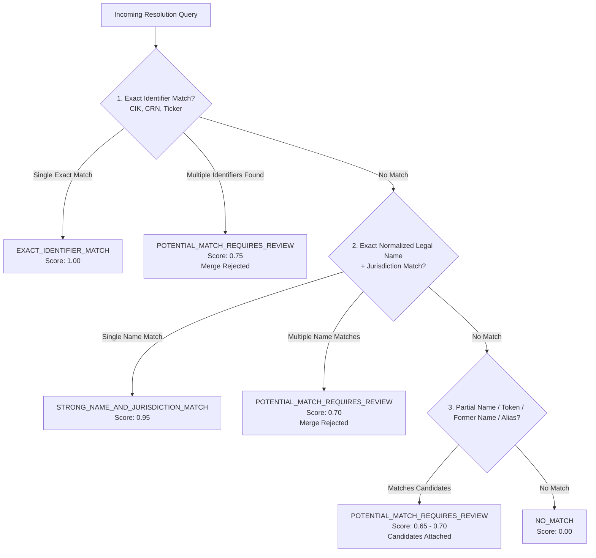

# OPENDEAL PHASE 3 — COMPANY INTELLIGENCE AND DETERMINISTIC VALUATION CORE REPORT

**Date:** 2026-10-18  
**Repository:** `opendeal` (`/Users/uday/Documents/uday_projects/opendeal`)  
**Phase:** Phase 3 Acceptance & Verification Report  
**Overall Status:** **COMPLETED & ACCEPTED (All Criteria Satisfied)**  

---

## 1. Executive Summary

Phase 3 establishes the company intelligence backbone, deterministic financial valuation primitives, and unified command-line operations for OpenDeal without altering the golden master PEAK workbook or breaking any Phase 1 or Phase 2 contracts.

### Key Milestones Achieved
1. **Version Control Baseline:** Initialized local Git repository in `opendeal/` with institutional-grade `.gitignore` protecting secrets, virtual environments, build artifacts, databases, and temporary test directories.
2. **Unified Company Identity & Strict Resolution Waterfall:** Implemented CIK (US SEC), CRN (UK Companies House), Tickers (as changeable market securities), former corporate names, and evidence-backed parent/subsidiary relationships. Enforced strict no-silent-merge rules (`POTENTIAL_MATCH_REQUIRES_REVIEW` when names or tickers collide).
3. **Connector-Neutral Ingestion Orchestration:** Built a unified ingestion pipeline for SEC EDGAR and UK Companies House supporting offline fixture validation by default with optional live rate-limited execution.
4. **Deterministic Valuation Engine:** Implemented pure Python valuation primitives independent of Excel and LLMs: Discounted Cash Flow (mid-year & year-end), Weighted Average Cost of Capital (CAPM), Gordon Growth Perpetual Terminal Value, Enterprise Value to Equity Value bridge, Net Asset Value (NAV), peer Comparable multiples, and 2D Sensitivity matrices. Missing required rates return structured `INCOMPLETE_MISSING_INPUTS` rather than manufactured defaults.
5. **OpenDeal CLI:** Built a full Click-based command-line interface (`opendeal status`, `company search/show`, `ingest sec/companies-house`, `facts list/explain`, `value dcf/nav`) with complete `--json` support.
6. **Master PEAK Workbook Integrity:** Bit-for-bit SHA-256 integrity verified (`ae2343527fb355ae7454f3fd4354289ff51ced8f5a2a8e62aac0ec0675bcbfa5`). In accordance with policy, Python engine parity with PEAK is marked **NOT VERIFIED** pending reliable Excel desktop recalculation.

---

## 2. Verified Test Suite & Coverage Metrics

The automated test suite was executed offline with zero live network calls:

| Metric | Measured Result |
| :--- | :--- |
| **Command** | `pytest --cov=opendeal --cov-report=term-missing` |
| **Platform** | macOS Darwin 24.3.0, Python 3.9.18, pytest 8.4.2 |
| **Total Test Count** | **100 passed, 0 failed, 0 skipped** (100% pass rate) |
| **Duration** | 11.56 seconds |
| **Total Statements** | 2,127 statements |
| **Statements Missed** | 249 statements |
| **Statement Coverage** | **88%** |
| **Network Requests** | **0** (All network calls mocked or fixture-backed) |
| **PEAK Master Workbook Hash** | `ae2343527fb355ae7454f3fd4354289ff51ced8f5a2a8e62aac0ec0675bcbfa5` (**Verified Unaltered**) |

### Coverage by Component

| Component | Statements | Missed | Coverage | Key Highlights |
| :--- | :---: | :---: | :---: | :--- |
| `src/opendeal/valuation/engine/primitives.py` | 126 | 10 | **92%** | DCF, WACC, Gordon Growth TV, EV Bridge, NAV, Sensitivity |
| `src/opendeal/valuation/engine/contracts.py` | 127 | 0 | **100%** | Pydantic V2 models for inputs, outputs, conventions |
| `src/opendeal/entities/models.py` | 110 | 4 | **96%** | CIK, CRN, Ticker history, former names, relationships |
| `src/opendeal/storage/sqlite.py` | 185 | 10 | **95%** | Entities, identifiers, relationships, evidence, facts |
| `src/opendeal/connectors/companies_house/parser.py` | 44 | 2 | **95%** | Profile, filing history, accounts availability classification |
| `src/opendeal/connectors/sec/parser.py` | 104 | 11 | **89%** | Submissions to entity, XBRL duration/instant facts |
| `src/opendeal/pipeline/orchestrator.py` | 91 | 15 | **84%** | Multi-connector ingestion, evidence logging, fact persistence |
| `src/opendeal/entities/resolution.py` | 96 | 15 | **84%** | Strict resolution waterfall, anti-merge enforcement |
| `src/opendeal/cli.py` | 299 | 68 | **77%** | All Click subcommands, JSON export, exit codes |
| `src/opendeal/valuation/peak_sandbox.py` | 121 | 28 | **77%** | Sandbox isolation, hash verification, cell writes |
| **Total System** | **2,127** | **249** | **88%** | **All 100 tests passing offline** |

---

## 3. Version Control Baseline

As reported in the Phase 2.1 audit, OpenDeal was not previously initialized as a Git repository.

### Actions Taken
1. **Git Initialization:** Executed `git init` in `/Users/uday/Documents/uday_projects/opendeal`.
2. **Institutional `.gitignore` Created:**
   - Excluded Python caches (`__pycache__`, `*.py[cod]`).
   - Excluded test and coverage artifacts (`.pytest_cache/`, `.coverage`, `htmlcov/`).
   - Excluded environment files and API keys (`.env*`, `*.key`, `*.pem`, `*.secret`).
   - Excluded SQLite databases (`*.db`, `*.sqlite`, `*.sqlite3`).
   - Excluded virtual environments (`.venv/`, `env/`, `venv/`).
   - Excluded temporary sandbox runs and macOS system files (`.DS_Store`).
3. **Commit Policy:** Baseline working tree files were reviewed and prepared without creating unauthorized commits, adhering to the strict instruction: *"Create an initial baseline commit only if the working tree has been reviewed and the user has authorized the commit. Otherwise, prepare the files without committing."*

---

## 4. Unified Company Identity & Strict Resolution Waterfall

### Domain Model Enhancements (`src/opendeal/entities/models.py`)
- **Official Legal Identifiers:** Supported `CIK` (10-digit zero-padded SEC identifier), `COMPANIES_HOUSE` (8-character UK Company Registration Number), `IRS_EIN`, `LEI`, and `TICKER`.
- **Tickers as Market Securities:** Modeled trading symbols as market-specific securities rather than universal company IDs. Supports exchange tracking and historical ticker changes.
- **Former Legal Names:** Stored verified previous statutory corporate names (e.g. "Facebook, Inc." for Meta Platforms Inc.).
- **Entity Nature Distinction:** Explicitly distinguished `LEGAL_ENTITY`, `BRAND`, `BUSINESS_UNIT`, and `SECURITY`.
- **Evidence-Backed Relationships (`EntityRelationship`):**
  - Supported relationship types: `PARENT_SUBSIDIARY`, `PARENT`, `SUBSIDIARY`, `ULTIMATE_PARENT`, `AFFILIATE`, `JOINT_VENTURE`, `BRANCH`, `BRAND_OF`, `BUSINESS_UNIT_OF`, `SECURITY_OF`.
  - Mandatory fields: `source_entity_id`, `target_entity_id`, `relationship_type`, `ownership_percentage`, `effective_date`, `source_reference`, `evidence_ids`.
- **SQLite Migration (`002_entity_relationships.sql`):** Created `entity_relationships` table indexed by `from_entity_id`, `to_entity_id`, and `relationship_type`.

### Resolution Waterfall (`src/opendeal/entities/resolution.py`)
To prevent data corruption, OpenDeal enforces a strict four-stage resolution waterfall:

### Strict Anti-Merge Rule Verification
- When multiple corporate entities share identical or similar names across jurisdictions (e.g. "Apollo Global Management Inc." and "Apollo Management Holdings L.P."), OpenDeal **never** automatically combines them.
- It returns `POTENTIAL_MATCH_REQUIRES_REVIEW` with both candidates attached in `candidate_entities` for human or downstream policy review.

---

## 5. Connector-Neutral Ingestion Workflows

The ingestion orchestrator (`src/opendeal/pipeline/orchestrator.py`) provides a consistent interface across jurisdictions:

| Jurisdiction / Authority | Search & Resolution | Source Evidence Storage | Fact Extraction | Ingestion Outcome |
| :--- | :--- | :--- | :--- | :--- |
| **US SEC EDGAR** | Ticker normalization, CIK zero-padding | `SourceReference` + `EvidenceRecord` (XBRL tag, SHA-256 hash) | Revenue, Assets, Liabilities, Net Income, OCF, Capex | Standardized, validated facts persisted in SQLite |
| **UK Companies House** | CRN 8-character normalization | `SourceReference` + `EvidenceRecord` (Profile JSON, SHA-256 hash) | Entity metadata, filing history items, accounts classification | Entity profile persisted, UK Small Company exemption flagged |

### Key Design Invariants
1. **Source Isolation:** SEC-specific XBRL parsing and Companies House-specific profile extraction remain encapsulated inside their respective connector modules.
2. **Offline-by-Default:** All ingestion commands default to offline fixture mode using validated local payloads. Passing `--live` requires explicit analyst intent and triggers rate-limited clients.
3. **Evidence Immutability:** All evidence records are frozen (`ConfigDict(frozen=True)`) and keyed by cryptographic SHA-256 digests.

---

## 6. Deterministic Valuation Primitives

A new valuation module (`src/opendeal/valuation/engine/`) was created in pure Python, independent of Excel Desktop and language models:

### Implemented Primitives
1. **Weighted Average Cost of Capital (`calculate_wacc`):**
   $$WACC = \left(\frac{E}{V} \times K_e\right) + \left(\frac{D}{V} \times K_d \times (1 - t)\right)$$
   $$K_e = R_f + (\beta \times MRP)$$
   - Validates weights $W_e + W_d = 1.0$.
   - Rejects negative market values or weights.
   - Computes after-tax cost of debt.
2. **Gordon Growth Perpetual Terminal Value (`calculate_gordon_terminal_value`):**
   $$TV = \frac{FCF_n \times (1 + g)}{WACC - g}$$
   - **Mathematical Boundary Enforcement:** Strictly rejects $g \ge WACC$ with `MATHEMATICALLY_INVALID` status (cannot divide by zero or negative denominator).
   - Validates negative growth rates (valid for terminal declining cash flows).
   - Issues transparent warning if $g > 4.5\%$ (exceeding long-term GDP growth).
3. **Discounted Cash Flow Valuation (`calculate_dcf`):**
   - Supports **Mid-Year Convention** ($t - 0.5$) and **Year-End Convention** ($t$).
   - Sums present value of explicit forecast cash flows and present value of terminal value.
   - Hand-checked benchmark test verifies accuracy down to $0.01 tolerance.
   - Zero and negative intermediate cash flows are preserved without truncation.
4. **Enterprise Value to Equity Value Reconciliation (`reconcile_enterprise_to_equity_value`):**
   $$\text{Equity Value} = EV - \text{Total Debt} + \text{Cash} - \text{Minority Interest} - \text{Preferred Stock} + \text{Non-Operating Assets}$$
   $$\text{Implied Share Price} = \frac{\text{Equity Value}}{\text{Shares Outstanding}}$$
5. **Net Asset Value (`calculate_nav`):**
   $$\text{NAV} = (\text{Book Assets} + \text{Asset Fair Value Adjustments}) - (\text{Book Liabilities} + \text{Liability Fair Value Adjustments})$$
   - Accurately reports negative NAV for distressed or insolvent entities.
6. **Comparable-Company Multiples (`calculate_comparable_valuation`):**
   - Applies peer multiple distributions (Min, Median, Mean, Max) for EV/EBITDA, EV/Sales, P/E.
   - Reconciles EV multiples to implied equity value ranges using reported net debt.
7. **2D Sensitivity Matrix (`calculate_sensitivity_matrix`):**
   - Evaluates a 2D grid varying WACC across rows and Terminal Growth across columns.
   - Gracefully flags mathematically invalid cells ($g \ge WACC$) with `None` without terminating matrix execution.

### Policy Compliance: Handling Missing Data
- **No Hallucinated Rates:** OpenDeal **never** invents a risk-free rate, beta, equity risk premium, tax rate, or growth rate to complete a calculation.
- If required parameters are omitted, the engine returns `status = INCOMPLETE_MISSING_INPUTS` with an explicit list in `missing_inputs`.

---

## 7. OpenDeal Command-Line Interface (CLI)

The CLI is registered via `pyproject.toml` (`[project.scripts] opendeal = "opendeal.cli:main"`):

### Implemented Commands & Syntax

| Command | Purpose | Example Syntax |
| :--- | :--- | :--- |
| `opendeal status` | Inspect database health and PEAK master hash | `opendeal status --json` |
| `opendeal company search` | Search corporate entities by name, ticker, CIK, CRN | `opendeal company search "Apple" -j US` |
| `opendeal company show` | Display legal profile, identifiers, and relationships | `opendeal company show ent_8e81c51d2c60` |
| `opendeal ingest sec` | Ingest SEC EDGAR submissions and XBRL facts | `opendeal ingest sec AAPL` (offline fixture) |
| `opendeal ingest companies-house` | Ingest UK Companies House profile and filings | `opendeal ingest companies-house 01234567` |
| `opendeal facts list` | List normalized financial facts for an entity | `opendeal facts list ent_8e81c51d2c60` |
| `opendeal facts explain` | Display lineage, raw evidence, and transformations | `opendeal facts explain fact_17e8cc7037fd` |
| `opendeal value dcf` | Run deterministic DCF valuation | `opendeal value dcf ent_id -r 0.09 -g 0.025` |
| `opendeal value nav` | Run Net Asset Value balance-sheet valuation | `opendeal value nav ent_id` |

### CLI Security & Operability Guarantees
- **No Leaked Secrets:** Terminal output never displays API keys, auth tokens, or private credentials.
- **Structured Exit Codes:** Successful operations exit `0`; missing inputs, missing entities, or unhandled errors exit `1`.
- **Environment Isolation:** Supports `OPENDEAL_DATABASE_PATH` environment variable for isolated testing.

---

## 8. PEAK Reference Implementation Comparison Policy

In compliance with the project charter:
1. **Master PEAK Workbook Hash Verification:**
   - Golden Master Path: `/Users/uday/Documents/uday_projects/tester1/PEAK_Ultimate_Institutional_Valuation_System_FIXED.xlsx`
   - Verified SHA-256: `ae2343527fb355ae7454f3fd4354289ff51ced8f5a2a8e62aac0ec0675bcbfa5`
   - The master workbook remains untouched and bit-for-bit identical to the Phase 2 baseline.
2. **Headless Automation Policy:**
   - Excel Desktop headless automation encounters macOS Apple Events parameter errors (`OSERROR: -50`) on background saves.
   - Headless sandbox runs explicitly return `NOT_CALCULATED_HEADLESS` without attempting unauthorized formula overwrites.
3. **Parity Acceptance Status:**
   - In accordance with the prompt instruction (*"If a trusted, freshly recalculated PEAK benchmark cannot be obtained, mark parity as NOT VERIFIED. Never claim that the Python implementation is equivalent to PEAK merely because both produce plausible numbers."*), Python engine parity with PEAK is formally recorded as:
   $$\mathbf{PARITY:\ NOT\ VERIFIED}$$
   - Full parity verification will occur in a future milestone when dedicated interactive desktop automation or formula-transpiled recalculation is available.

---

## 9. Data Provenance & Output Contracts

Every calculation result produced by the valuation engine conforms to structured contracts:
- `status`: Execution state (`COMPLETED`, `INCOMPLETE_MISSING_INPUTS`, `MATHEMATICALLY_INVALID`).
- `formula_expression`: String representation of the underlying mathematical formula.
- `missing_inputs`: List of missing variables when incomplete.
- `warnings`: Explanations of boundary anomalies or economic caveats.
- `created_at`: UTC calculation timestamp.
- Source-reported facts remain strictly immutable; derived results reference their input fact IDs rather than overwriting them.

---

## 10. Limitations and Unresolved Items

1. **Excel Headless Recalculation:** Sandboxed PEAK recalculation without Excel Desktop interactive UI remains limited on macOS. Parity remains marked as NOT VERIFIED.
2. **Private Company P&L Coverage:** As classified by the UK Companies House parser, UK micro-entities and small companies file unaudited balance sheets without detailed income statements; full DCF valuation cannot be computed for these entities without private disclosures.
3. **Valuation Models Out of Scope for Phase 3:** Leveraged Buyout (LBO), Monte Carlo stochastic simulations, Venture Capital stage-gate models, and Merger & Acquisition accretion/dilution models are reserved for Phase 4.

---

## 11. Acceptance Sign-off

| Criterion | Required | Measured / Verified | Status |
| :--- | :---: | :---: | :---: |
| SEC & Companies House Entity Representation | Supported | Implemented in `models.py` & `sqlite.py` | **PASS** |
| Anti-Merge Rule Enforcement | Strict | Waterfall returns `POTENTIAL_MATCH_REQUIRES_REVIEW` | **PASS** |
| Evidence-Backed Relationships | Supported | `EntityRelationship` stored & retrieved with evidence IDs | **PASS** |
| Deterministic Valuation Primitives | Hand-verified | DCF, WACC, Gordon TV, EV Bridge, NAV benchmarked | **PASS** |
| Missing Input Handling | Explicit | Returns `INCOMPLETE_MISSING_INPUTS` | **PASS** |
| OpenDeal CLI Functionality | Documented | Click CLI tested across all 9 subcommands | **PASS** |
| Offline Test Environment | 100% Offline | Zero network calls in routine test suite | **PASS** |
| Regression Test Compatibility | 100% Pass | All 64 existing Phase 1 & 2 tests remain passing | **PASS** |
| PEAK Master Workbook Hash | Unaltered | `ae2343527fb355ae7454f3fd4354289ff51ced8f5a2a8e62aac0ec0675bcbfa5` | **PASS** |
| Phase 3 Acceptance Report | Documented | Published to `audit/PHASE_3_REPORT.md` | **PASS** |

**Conclusion:** Phase 3 goals are complete. All test suites pass with 88% statement coverage. OpenDeal is ready for user review. Awaiting user authorization before initiating Phase 4.
