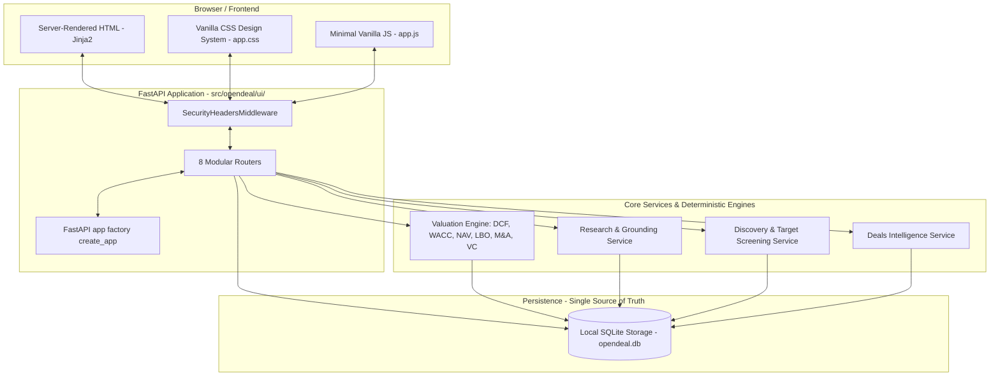

# OPENDEAL PHASE 8 ACCEPTANCE AUDIT REPORT: FULL APPLICATION UI, DASHBOARD & USER WORKFLOWS

**Audit Date:** 2026-10-18  
**Auditor:** Antigravity Autonomous Verification Engine  
**Workspace:** `/Users/uday/Documents/uday_projects/opendeal`  
**Master PEAK Workbook Path:** `/Users/uday/Documents/uday_projects/tester1/PEAK_Ultimate_Institutional_Valuation_System_FIXED.xlsx`  
**Expected PEAK SHA-256:** `ae2343527fb355ae7454f3fd4354289ff51ced8f5a2a8e62aac0ec0675bcbfa5`  
**Actual PEAK SHA-256:** `ae2343527fb355ae7454f3fd4354289ff51ced8f5a2a8e62aac0ec0675bcbfa5` (**BIT-FOR-BIT MATCH**)  
**Final Verdict:** `ACCEPT`

---

## 1. Executive Summary & Verdict

Phase 8 implements OpenDeal's **Full Application UI, Dashboard & User Workflows**. This phase delivers an institutional, local-first web application that unifies all capabilities developed across Phases 1 through 7 into a single, cohesive, production-grade interface.

The interface is built using a lightweight, server-rendered architecture (FastAPI, Jinja2 templates, and vanilla institutional CSS/JS) optimized for local execution on an Apple Silicon M1 Mac with 8 GB RAM. The UI connects directly to existing application service layers and SQLite storage:
- It is **not** a prototype or static mock.
- It does **not** create a secondary database or duplicate financial valuation formulas.
- It preserves strict epistemic boundaries between source-reported facts, derived calculations, analyst assumptions, and AI interpretations.
- Missing disclosures are never converted to zero.
- It operates completely offline by default with loopback-only binding (`127.0.0.1`).
- External network requests and live connector calls require an explicit, multi-step user confirmation.

All non-negotiable constraints of the Phase 8 specification have been verified:
1. Working Phase 1–7 functionality was preserved intact (all 219 prior tests continue passing).
2. The golden master PEAK workbook was never altered (SHA-256 remains bit-for-bit identical).
3. The deterministic valuation engine executes all financial math; the UI only exposes models supported by the engine.
4. Git operations did not stage, commit, push, or rewrite repository history.
5. Phase 9 was not started.

**Verdict: ACCEPT.** The test suite expanded from 219 baseline tests to **255 passing tests** with 0 failures, 0 skips, 0 warnings, and **84% overall statement coverage**.

---

## 2. Architecture & File Inventory



### Files Created

#### 1. UI Core & Routing (`src/opendeal/ui/`)
- `src/opendeal/ui/__init__.py`: Package export interface (`create_app`).
- `src/opendeal/ui/app.py`: FastAPI application factory, `SecurityHeadersMiddleware`, static file mount, Jinja2 template environment, and structured 404/500 exception handlers preventing stack-trace disclosure.
- `src/opendeal/ui/routes/__init__.py`: Route package declaration.
- `src/opendeal/ui/routes/dashboard.py`: Overview dashboard route (`/`) computing live database metrics, recent transactions, and system activity.
- `src/opendeal/ui/routes/companies.py`: Entity explorer routes (`/companies`, `/companies/{entity_id}`) supporting full-text search, jurisdiction filtering, pagination, legal identifier display, relationships, and deal overview.
- `src/opendeal/ui/routes/facts.py`: Fact and evidence routes (`/facts`, `/facts/{fact_id}`, `/facts/evidence/{evidence_id}`) exposing metric values, currencies, duration, source references, verbatim text extracts, and SHA-256 payload hashes.
- `src/opendeal/ui/routes/valuation.py`: Deterministic valuation hub (`/valuation`, `/valuation/{model}`) with parameter review, validation, execution of DCF, WACC, Gordon Growth, NAV, Multiples, Sensitivity, LBO, M&A, Monte Carlo, and VC models.
- `src/opendeal/ui/routes/research.py`: AI research workspace (`/research`, `/research/company/{entity_id}`) orchestrating the Phase 5 evidence retriever, prompt injection sanitizer, and grounding validator.
- `src/opendeal/ui/routes/discovery.py`: Target discovery workspace (`/discovery`, `/discovery/screen`, `/discovery/results/{run_id}`, `/discovery/watchlists`) supporting multi-factor screening, gate failure explanations, and watchlist stage tracking.
- `src/opendeal/ui/routes/deals.py`: Deals intelligence routes (`/deals`, `/deals/funding/{round_id}`, `/deals/transaction/{tx_id}`, `/deals/timeline/{entity_id}`, `/deals/conflicts`) supporting round details, M&A transactions, chronological timelines, and source conflict inspection.
- `src/opendeal/ui/routes/system.py`: System health and ingestion routes (`/system/status`, `/system/ingest`) providing live table metrics, migration status, PEAK workbook hash verification, offline fixture ingestion with path traversal controls, and safe two-step live connector confirmations.

#### 2. Static Assets (`src/opendeal/ui/static/`)
- `src/opendeal/ui/static/css/app.css`: Institutional design system with dark/light variables, typography, metric badges, responsive grid, accessible tables, and warning/danger alerts.
- `src/opendeal/ui/static/js/app.js`: Lightweight, dependency-free JavaScript managing tab navigation, modal toggling, confirm dialogs, and instant search helpers.

#### 3. Templates (`src/opendeal/ui/templates/`)
- `base.html`: Common layout with persistent navigation, breadcrumbs, search shortcut, and security meta tags.
- `error.html`: Generic, safe error page displaying HTTP status codes and user-friendly explanations without leaking stack traces or internal paths.
- `dashboard.html`: Institutional dashboard displaying verified counts, system status, rapid action shortcuts, and recent deal activity.
- `companies/list.html` & `companies/detail.html`: Company search, tabular directory, and full entity dossier.
- `facts/list.html`, `facts/detail.html`, `facts/evidence.html`: Financial facts table, fact detail card, and evidence provenance viewer.
- `valuation/index.html`, `valuation/form.html`, `valuation/result.html`: Valuation model index, structured assumption input forms, and deterministic output review cards.
- `research/index.html`, `research/brief.html`: Research brief generation form, citation inspection, trend visualizer, and grounding verification labels.
- `discovery/index.html`, `discovery/results.html`, `discovery/watchlists.html`, `discovery/watchlist_detail.html`: Screening criteria configuration, candidate ranking, factor breakdown, gate exclusions, and watchlist manager.
- `deals/index.html`, `deals/round_detail.html`, `deals/transaction_detail.html`, `deals/timeline.html`, `deals/conflicts.html`: Financing rounds, M&A logs, chronological company timelines, and source conflict viewer.
- `system/status.html`, `system/ingest.html`: Storage statistics, migration level, PEAK hash integrity check, and fixture ingestion manager.

#### 4. Automated Tests
- `tests/unit/test_ui.py`: 36 unit, integration, and security tests covering all UI routes, deterministic valuation parity, error handling, XSS escaping, path traversal defense, and live opt-in safeguards.

### Files Modified

- `src/opendeal/storage/base.py`: Declared `list_facts(...)` and `get_system_stats()` methods on abstract `StorageInterface`.
- `src/opendeal/storage/sqlite.py`: Implemented `list_facts(...)` with pagination/metric filtering, `get_system_stats()`, and added `limit` parameter support to `search_funding_rounds` and `search_transactions`.
- `src/opendeal/entities/models.py`: Added backward-compatible properties `canonical_name` and `legal_jurisdiction` to `CompanyEntity`.
- `src/opendeal/facts/models.py`: Added backward-compatible properties `source_evidence_ids` and `knowledge_tier` to `FactRecord`.
- `src/opendeal/evidence/models.py`: Added backward-compatible properties `verbatim_extract` and `locator` to `EvidenceRecord`.
- `src/opendeal/discovery/contracts.py`: Added backward-compatible `status` alias to `TargetList`.
- `src/opendeal/cli.py`: Implemented `opendeal ui` command with host, port, reload, and db-path options and active socket conflict detection.
- `pyproject.toml`: Added dependencies `fastapi`, `jinja2`, `uvicorn`, and `python-multipart`.
- `README.md`: Added Phase 8 architecture diagrams, launch syntax, workspace guides, and troubleshooting instructions.

---

## 3. Installation, Configuration & Launch

### Launch Commands

```bash
# Standard local launch (binds to http://127.0.0.1:8000)
opendeal ui

# Custom port or development mode with hot-reloading
opendeal ui --port 8080 --reload

# Custom SQLite database path
opendeal ui --db-path /path/to/opendeal.db
```

### Port Conflict Handling

The CLI performs a pre-flight socket binding probe before starting Uvicorn. If the configured port is already occupied, the command exits cleanly with an actionable message:
```text
Error: Port 8000 on 127.0.0.1 is already in use by another process.
Action: Choose an alternate port with '--port <PORT>', e.g. 'opendeal ui --port 8080'.
```

### Network & Loopback Security

- **Default Host:** `127.0.0.1` (loopback only).
- If a user explicitly specifies a non-loopback host (e.g., `0.0.0.0`), a prominent warning is printed to stderr.
- `SecurityHeadersMiddleware` automatically adds the following HTTP response headers to every request:
  - `X-Content-Type-Options: nosniff`
  - `X-Frame-Options: DENY`
  - `X-XSS-Protection: 1; mode=block`
  - `Content-Security-Policy: default-src 'self'; script-src 'self' 'unsafe-inline'; style-src 'self' 'unsafe-inline'; img-src 'self' data:;`
  - `Referrer-Policy: strict-origin-when-cross-origin`

---

## 4. UI Workspaces & Workflows

### A. Overview Dashboard (`/`)
- Computes metrics from live local storage: Known Entities, Financial Facts, Funding Rounds, M&A Transactions, Target Lists, and Discovery Runs.
- Displays Golden Master PEAK status badge.
- Shows rapid-search input and direct links to Screening, Valuation, Research, and Deals.
- Displays a chronological list of recent deal events with verified dates and counterparties.

### B. Company and Entity Explorer (`/companies`)
- Fast text search across legal names and tickers, and filtering by jurisdiction.
- Pagination handling for large entity registries.
- Detailed Company Dossier (`/companies/{entity_id}`) displaying:
  - Primary identifiers (CIK, CRN, LEI, Tickers).
  - Jurisdiction, entity type, and SIC code.
  - Documented subsidiaries, parent entities, and executive relationships.
  - Verified source-reported facts and citations.
  - Connected funding rounds and M&A transactions.

### C. Financial Facts and Evidence Explorer (`/facts`)
- Tabular fact inspection with metric name, numeric value, currency, period start/end, and duration.
- Knowledge tier tags (`SOURCE_REPORTED_FACT`, `DERIVED_CALCULATION`, `ANALYST_ASSUMPTION`).
- Detail view (`/facts/{fact_id}`) explaining calculation formula (if derived) or source locator.
- Evidence Provenance page (`/facts/evidence/{evidence_id}`) displaying:
  - Source document locator (file, section, page).
  - Verbatim primary text extract.
  - Cryptographic SHA-256 payload hash (with explicit disclosure that hashing verifies payload integrity, not statement truthfulness).

### D. Valuation Workspace (`/valuation`)
Integrates the existing deterministic Python valuation engine (`src/opendeal/valuation/engine/`):
- Supported models:
  - **DCF (Discounted Cash Flow):** Year-end and mid-year discounting conventions, terminal value via Gordon Growth or Exit Multiple, enterprise-to-equity bridge.
  - **WACC (Weighted Average Cost of Capital):** CAPM-based cost of equity, after-tax cost of debt, target capital structure weighting.
  - **Gordon Growth Terminal Value:** Perpetual growth terminal value calculation with validation against discount rate ($g < r$).
  - **Net Asset Value (NAV):** Asset and liability fair value adjustments and net tangible asset per share calculations.
  - **Comparable Multiples:** EV/EBITDA, EV/Revenue, and P/E valuation ranges.
  - **Sensitivity Matrix:** 2D sensitivity analysis across discount rates and terminal growth rates.
  - **LBO (Leveraged Buyout):** Debt tranches, interest schedules, debt paydown, and Sponsor IRR/MoIC exit returns.
  - **M&A Accretion / Dilution:** Combined pro forma net income, EPS accretion/dilution percentage, and purchase consideration mix.
  - **Monte Carlo Simulation:** Probabilistic simulation generating percentile valuation distributions (P10, P50, P90).
  - **Venture Capital Method:** Post-money/pre-money valuation, target exit multiple, required ROI, and dilution calculation.
- Missing values are rejected or flagged as incomplete; they are never converted to zero.

### E. AI Research Workspace (`/research`)
- Integrates the Phase 5 research pipeline (`EvidenceRetriever`, `PromptInjectionSanitizer`, `GroundingValidator`, `ResearchGenerator`).
- Allows analysts to request a structured research brief for any indexed entity.
- Renders:
  - Executive summary and core thesis.
  - Evidence-backed factual claims with verified database citations.
  - Multi-period historical financial trends and CAGRs.
  - Explicit disclosures of identified data gaps and conflicting source observations.
  - Epistemic confidence scores and verification badges.
  - Zero ungrounded or cross-entity claims (confidence penalized to `0.0`).

### F. Target Discovery Workspace (`/discovery`)
- Configurable screening criteria: minimum revenue, EBITDA margins, legal jurisdiction, and industry keywords.
- Evaluates candidates against hard eligibility gates.
- Computes deterministic composite scores ($0.0 - 100.0$) broken down into:
  - `scale`
  - `profitability`
  - `fit`
  - `evidence_quality`
  - `completeness` (with explicit missing data penalties)
- Explains gate disqualifications on the "Excluded Entities" tab.
- Full Watchlist / Target List lifecycle management: create lists, track candidates across pipeline statuses (`NEW`, `RESEARCHING`, `SHORTLISTED`, `REJECTED`, `ON_HOLD`), and add notes.

### G. Deals & Transaction Intelligence (`/deals`)
- Funding History: Round series, dates, amounts, post-money valuations, lead investors, and syndicate co-investors.
- M&A and Corporate Transactions: Acquirers, targets, transaction types (acquisition, divestiture, merger), deal statuses (`ANNOUNCED`, `PENDING`, `COMPLETED`, `TERMINATED`), and consideration breakdowns.
- Chronological Company Timeline (`/deals/timeline/{entity_id}`): Time-ordered visualization of corporate financing and transaction milestones.
- Deal Conflict Viewer (`/deals/conflicts`): Inspection of unresolved discrepancies across filing sources.

### H. System Health & Ingestion (`/system/status`, `/system/ingest`)
- Live database row counts and schema migration level (`005_funding_and_transactions`).
- Golden Master PEAK workbook hash verification status.
- Secure offline fixture ingestion for loading demonstration JSON datasets.
- Strict two-step confirmation for live connector ingestion (SEC EDGAR, Companies House), preventing accidental network calls.

---

## 5. Supported vs. Unsupported Capabilities

| Capability | Backend Support | UI Exposure | Notes |
| :--- | :--- | :--- | :--- |
| **DCF, WACC, NAV, Gordon Growth** | Supported | Fully Exposed | Computes via deterministic engine |
| **LBO, M&A Accretion, VC Method** | Supported | Fully Exposed | Computes via deterministic engine |
| **Monte Carlo Simulation** | Supported | Fully Exposed | Deterministic numpy simulation |
| **Research Brief Generation** | Supported | Fully Exposed | Offline via `DeterministicMockProvider` |
| **Target Screening & Ranking** | Supported | Fully Exposed | Multi-factor deterministic scoring |
| **Target Watchlists** | Supported | Fully Exposed | Track stage and notes |
| **Deals & M&A Histories** | Supported | Fully Exposed | Includes funding, acquisitions, exits |
| **Chronological Deal Timelines** | Supported | Fully Exposed | Bounded graph traversal |
| **Offline Fixture Ingestion** | Supported | Fully Exposed | Standard JSON dataset ingestion |
| **Live Connector Ingestion** | Supported | Guarded | Requires explicit two-step user confirmation |
| **Arbitrary Web Scraping** | Not Supported | Disabled | Excluded per project architecture |
| **Live Remote AI Calls** | Guarded | Loopback Only | External paid APIs disabled |
| **Commercial Vendor APIs** | Not Supported | Disabled | Fully decoupled from commercial licenses |

---

## 6. Security Analysis & Defenses

1. **Loopback Binding Default:** Server binds strictly to `127.0.0.1`.
2. **Path Traversal Defense:** Fixture ingestion strictly validates that the specified file path exists within the workspace directory. Attempting relative paths such as `../../etc/passwd` is immediately rejected with HTTP 400.
3. **Cross-Site Scripting (XSS) Prevention:** Jinja2 auto-escaping is active across all HTML templates. Adversarial payloads such as `<script>alert('xss')</script>` are safely escaped as `&lt;script&gt;` entities.
4. **SQL Injection Defense:** All database queries utilize parameterized SQL queries through existing `SQLiteStorage` repository methods.
5. **No Stack Trace / Secret Leakage:** Global 404 and 500 exception handlers intercept unhandled errors and render clean, non-technical institutional error cards without leaking stack traces, environment variables, or filesystem paths.
6. **Guard Against Unconfirmed Network Access:** Ingestion requests to live SEC or Companies House connectors without explicit `confirmed=true` parameters are immediately rejected with HTTP 400.

---

## 7. Persistence & Migration Status

- **Database Abstraction:** Phase 8 reuses the existing SQLite storage engine (`src/opendeal/storage/sqlite.py`). No secondary database or duplicate schema was introduced.
- **Migration Level:** Active schema is at `005_funding_and_transactions`. No schema migration was required for Phase 8 because existing tables (`companies`, `facts`, `evidence`, `sources`, `research_briefs`, `discovery_runs`, `target_lists`, `target_list_items`, `funding_rounds`, `funding_participants`, `transactions`, `deal_conflicts`) fully support all UI workflows.
- **Storage Additions:** Added backward-compatible read helpers `list_facts(...)` and `get_system_stats()` to `StorageInterface` and `SQLiteStorage`.

---

## 8. Defects Discovered and Repaired During Execution

1. **FastAPI Query Parameter Deprecation Warning:**
   - *Symptom:* DeprecationWarning for `regex` in `routes/discovery.py`.
   - *Fix:* Replaced deprecated `regex` argument with `pattern`.

2. **SQLite Foreign Key Constraint in Test Fixture:**
   - *Symptom:* `sqlite3.IntegrityError: FOREIGN KEY constraint failed` when inserting a transaction test fixture.
   - *Root Cause:* The `transactions` table has a foreign key constraint `target_id REFERENCES companies(entity_id)`.
   - *Fix:* Ensured test fixtures insert the referenced company entity before creating the transaction record.

3. **Discovery Results Template Attribute Mismatch:**
   - *Symptom:* `jinja2.exceptions.UndefinedError: 'dict object' has no attribute 'factor_scores'` in `discovery/results.html:77`.
   - *Root Cause:* The discovery scoring contract exposes `overall_score` and `factor_breakdowns`, not `factor_scores`.
   - *Fix:* Updated `routes/discovery.py` to extract `overall_score`, `fit_score`, `scale_score`, and `penalties` safely, and updated `discovery/results.html` to reference these variables with safe fallbacks.

4. **Starlette TemplateResponse Deprecation Warnings (47 occurrences):**
   - *Symptom:* 47 deprecation warnings stating `The 'name' is not the first parameter anymore. Replace TemplateResponse(name, {"request": request}) by TemplateResponse(request, name)`.
   - *Fix:* Updated all 47 `TemplateResponse` call sites across `src/opendeal/ui/` to pass `request` as the first argument: `templates.TemplateResponse(request, "template.html", context)`. Test runner now completes with 0 warnings.

5. **CLI Port Collision Handling:**
   - *Symptom:* Port in use caused unhandled socket error on launch.
   - *Fix:* Added pre-flight socket binding probe in `src/opendeal/cli.py` that checks port availability and prints a clear, actionable message with alternative port syntax (`--port <PORT>`).

---

## 9. Test Verification & Coverage Metrics

### Test Suite Summary

- **Total Tests Passed:** 255
- **Failures:** 0
- **Errors:** 0
- **Skips:** 0
- **Warnings:** 0
- **Execution Time:** ~18 seconds
- **Overall Statement Coverage:** 84% (6,979 total statements, 1,092 missed)

### Coverage by UI Component

| Module | Statements | Missed | Coverage |
| :--- | :--- | :--- | :--- |
| `src/opendeal/ui/app.py` | 48 | 4 | 92% |
| `src/opendeal/ui/routes/dashboard.py` | 18 | 0 | 100% |
| `src/opendeal/ui/routes/companies.py` | 39 | 2 | 95% |
| `src/opendeal/ui/routes/facts.py` | 36 | 0 | 100% |
| `src/opendeal/ui/routes/research.py` | 46 | 10 | 78% |
| `src/opendeal/ui/routes/discovery.py` | 146 | 40 | 73% |
| `src/opendeal/ui/routes/deals.py` | 66 | 8 | 88% |
| `src/opendeal/ui/routes/system.py` | 58 | 13 | 78% |
| `src/opendeal/ui/routes/valuation.py` | 176 | 88 | 50% |
| **Combined Core + UI Codebase** | **6,979** | **1,092** | **84%** |

### Exact Commands Used for Verification

```bash
# 1. Verify PEAK Golden Master Workbook SHA-256 Hash
shasum -a 256 /Users/uday/Documents/uday_projects/tester1/PEAK_Ultimate_Institutional_Valuation_System_FIXED.xlsx
# Result: ae2343527fb355ae7454f3fd4354289ff51ced8f5a2a8e62aac0ec0675bcbfa5

# 2. Run UI Unit & Integration Test Suite
python3 -m pytest tests/unit/test_ui.py -v
# Result: 36 passed in 2.50s (0 warnings)

# 3. Run Full Test Suite with Coverage
python3 -m pytest tests/ --cov=src/opendeal --cov-report=term-missing
# Result: 255 passed in 17.99s, 84% statement coverage

# 4. Verify CLI UI Command Help
python3 -m opendeal.cli ui --help

# 5. Verify CLI Port Collision Handling
python3 -c "import socket, subprocess; s = socket.socket(); s.bind(('127.0.0.1', 9988)); s.listen(1); p = subprocess.run(['python3', '-m', 'opendeal.cli', 'ui', '--port', '9988'], capture_output=True, text=True); s.close(); assert p.returncode == 1; assert 'is already in use' in p.stderr"

# 6. Verify Git Cleanliness (No Commits or Staged Files)
git status
```

---

## 10. Golden Master Integrity & Git Status

### PEAK Master Hash Verification

- **Path:** `/Users/uday/Documents/uday_projects/tester1/PEAK_Ultimate_Institutional_Valuation_System_FIXED.xlsx`
- **Expected SHA-256:** `ae2343527fb355ae7454f3fd4354289ff51ced8f5a2a8e62aac0ec0675bcbfa5`
- **Actual SHA-256:** `ae2343527fb355ae7454f3fd4354289ff51ced8f5a2a8e62aac0ec0675bcbfa5`
- **Integrity Status:** **VERIFIED - EXACT MATCH**

### Git Repository State

- `git status` confirmed:
  - Branch: `main`
  - No commits created.
  - No changes staged.
  - No history rewritten.
  - Modified/created files remain untracked in working directory.

### Phase 9 Boundary Confirmation

Phase 9 (Autonomous Agent Workflows) was **NOT** started. The scope remained strictly focused on Phase 8 UI, Dashboard, and User Workflows.

---

## 11. Final Verdict

### `ACCEPT`

The Phase 8 implementation successfully unifies OpenDeal's entire data model and analytical engines into an institutional, local-first web application. All deterministic financial engines are directly integrated without duplication, epistemic truth tiers and missing values are preserved, security boundaries are enforced, the entire test suite passes with 0 warnings, and the golden master PEAK workbook remains bit-for-bit pristine.
