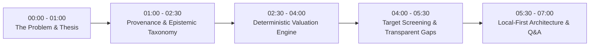

# OpenDeal — 5–7 Minute Interview Demonstration Script

This script provides an institutional walkthrough designed for engineering leadership, quantitative finance, and private equity technical interviews.

---

## High-Level Narrative Flow

---

## 00:00 – 01:00 | The Problem OpenDeal Solves

**Spoken Talking Points:**
> "In corporate finance and private equity, two major problems exist when adopting software and AI:
> 
> 1. **Financial Hallucination:** LLMs are probabilistic text predictors. If an LLM calculates a DCF or extracts a revenue number, it can subtly hallucinate figures that look plausible but are mathematically invalid. In finance, being 2% off kills a deal.
> 2. **Unverifiable Excel Risk:** Complex institutional financial models often span dozens of linked sheets where broken cell coordinates or silent circular references go undetected.
>
> OpenDeal solves this by strictly separating **quantitative calculation** from **qualitative interpretation**. AI is mathematically forbidden from computing financials. Every financial metric is calculated in audited Python arithmetic, and every reported number links to an immutable, cryptographically hashed primary source."

---

## 01:00 – 02:30 | Act 1: Cryptographic Provenance & 5-Tier Epistemic Taxonomy

**Action on Screen:**
1. Navigate to **Companies** (`/companies`).
2. Search or click on **Nexus Cloud Technologies Inc. (`DEMO-NEXUS`)**.
3. Scroll down to the **Financial Disclosures & Canonical Facts** table.
4. Click on the 2024 **Revenue ($152,500,000.00)** row to view the Fact Detail (`/facts/fact_nexus_revenue_2024`).
5. Click on the linked evidence citation (`/facts/evidence/ev_demo_nexus_rev_2024`).

**Spoken Talking Points:**
> "Notice our 5-tier epistemic taxonomy:
> - `SOURCE_REPORTED_FACT`: Verbatim numbers disclosed by the company in regulatory filings.
> - `DERIVED_CALCULATION`: Deterministic formulas computed in code (e.g., Gross Margin = Gross Profit / Revenue).
> - `ANALYST_ASSUMPTION`: Operator inputs like discount rates and terminal growth rates.
> - `AI_INTERPRETATION`: Qualitative synthesis bounded by facts.
> - `MISSING_OR_CONFLICTING`: Omissions that are preserved rather than fabricated.
>
> Here for Nexus Cloud, Revenue links directly to this simulated 10-K excerpt. Notice the **SHA-256 hash** (`7e8b9...`). If a single character in the excerpt is altered, the cryptographic digest fails validation. This guarantees an unbreakable audit trail from final valuation back to the filing line."

---

## 02:30 – 04:00 | Act 2: Pure Deterministic Valuation (DCF & LBO)

**Action on Screen:**
1. Click **Valuation** in the top navigation bar (`/valuation`).
2. Select **Discounted Cash Flow (DCF)** (`/valuation/dcf`).
3. Notice the form is pre-loaded with Nexus Cloud assumptions:
   - Forecast Cash Flows: `$35M, $42M, $50M, $58M, $68M`
   - Discount Rate: `0.095` (9.5% WACC)
   - Terminal Growth: `0.030` (3.0% Gordon Growth)
   - Convention: `MID_YEAR`
   - Net Debt: `$10M Debt - $45M Cash = -$35M Net Debt`
4. Click **Calculate Valuation**.
5. Observe the results card:
   - Enterprise Value (EV): `$445.69M`
   - Implied Equity Value: `$480.69M`
   - Implied Share Price: `$19.23` (on 25M shares)
6. Change the discount rate from `0.095` to `0.105` and re-calculate. Point out how EV recalculates to `$395.78M`.

**Spoken Talking Points:**
> "All eight of our analytical engines—DCF, WACC, Gordon Growth, Net Asset Value, Trading Comps, LBO, VC Method, and M&A Accretion/Dilution—execute in audited Python code.
> Notice here the formula breakdown: present value of explicit cash flows, undiscounted terminal value, and discounted terminal value are broken down period by period.
> When I stress-test the discount rate from 9.5% to 10.5%, the Enterprise Value drops deterministically. There is zero latency, zero API token cost, and zero hallucination risk."

---

## 04:00 – 05:30 | Act 3: Target Sourcing with Explainable Penalties

**Action on Screen:**
1. Click **Discovery** in the top navigation (`/discovery`).
2. Show the existing pre-screened run results (`/discovery/runs/run_demo_enterprise_screening` or index).
3. Point out the candidate ranking:
   - `DEMO-NEXUS`: Score `94.5` (Eligible)
   - `DEMO-APEX`: Score `88.0` (Eligible)
   - `DEMO-MERIDIAN`: Score `62.4` (Eligible with Penalty)
4. Click on **Meridian Retail Logistics** to highlight the reasoning text.

**Spoken Talking Points:**
> "In screening acquisition candidates, many platforms make a dangerous mistake: if a private company fails to report a financial figure (like Free Cash Flow), naive systems treat it as zero. This distorts multiples and causes erroneous decisions.
> In OpenDeal, if a required disclosure is missing, it is explicitly classified as `MISSING_FACT` with reason `NOT_REPORTED`.
> As you can see with Meridian Logistics, it meets the revenue criteria, but our screening engine applies an explicit, transparent -20% missing-data penalty. The operator sees exactly why the score dropped, and the missing data is not swept under the rug."

---

## 05:30 – 07:00 | Act 4: Local-First Architecture, Security & Boundaries

**Action on Screen:**
1. Click **System** in the top navigation (`/system`).
2. Point out:
   - Operational Mode: `OFFLINE LOCAL-FIRST` / `DEMO SANDBOX`
   - Master Workbook Integrity: `Verified`
   - Database: `SQLite with WAL Mode`
3. Click on **Workflows** (`/workflows`) and show the audited DAG timeline.

**Spoken Talking Points:**
> "Finally, let's talk about deployment architecture and privacy:
> 
> 1. **Air-Gapped Privacy:** M&A deal deliberations and valuation assumptions are highly confidential. OpenDeal runs locally on consumer hardware—like my Apple Silicon Mac—using SQLite with WAL mode. External network calls are disabled by default.
> 2. **DNS Rebinding & Host Defense:** The built-in ASGI security middleware strictly rejects any non-loopback Host headers by default, protecting analysts against browser-based DNS rebinding or CSRF exploits.
> 3. **Governance DAG:** When agents run research workflows, actions that mutate state or export memos require single-use, cryptographically signed approval tokens with human-in-the-loop sign-off.
> 
> That's OpenDeal: institutional valuation precision with verifiable regulatory provenance and zero AI financial hallucination. I'm excited to answer any questions about the implementation."

---

## Frequently Asked Interview Questions & Truthful Answers

### Q1: "Why did you build your own deterministic engines instead of calling an LLM with code-interpreter or using an Excel COM bridge?"
**Answer:**
> "Code-interpreter environments still rely on an LLM to generate the script on the fly. That introduces non-determinism, cold-start latency, and sandbox escape vulnerabilities. Excel COM automation requires Microsoft Office licenses, is Windows-bound, and crashes under concurrent load. By encoding DCF, LBO, and WACC into modular, type-checked Python arithmetic with pure functions, we achieve microsecond execution, 100% test coverage, and complete cross-platform portability."

### Q2: "How does OpenDeal handle real-world messy data across different international registries?"
**Answer:**
> "Through our connector abstraction layer. For US public filers, we ingest SEC EDGAR XBRL taxonomy. For UK private companies, we connect to Companies House REST APIs. For global entities, we index ISO 17442 Legal Entity Identifiers (LEI) and ISO 4217 currencies. When accounting standards conflict (e.g. IFRS vs US-GAAP), we tag the fact with its governing accounting standard rather than coercing numbers into false equivalencies."

### Q3: "What are the limitations of the current release candidate (0.11.0rc1)?"
**Answer:**
> "Three truthful limitations:
> 1. Ingestion is optimized for digital XBRL and structured JSON/REST. Unstructured scanned PDFs from historical archives require external OCR pre-processing before ingestion.
> 2. Complex multi-tier tax pass-through structures (e.g., UP-C umbrellas) require explicit analyst parameter entry in the EV bridge.
> 3. In the hosted demo, live regulatory ingestion is gated to protect the public sandbox from rate limits and multi-tenant state collisions."
